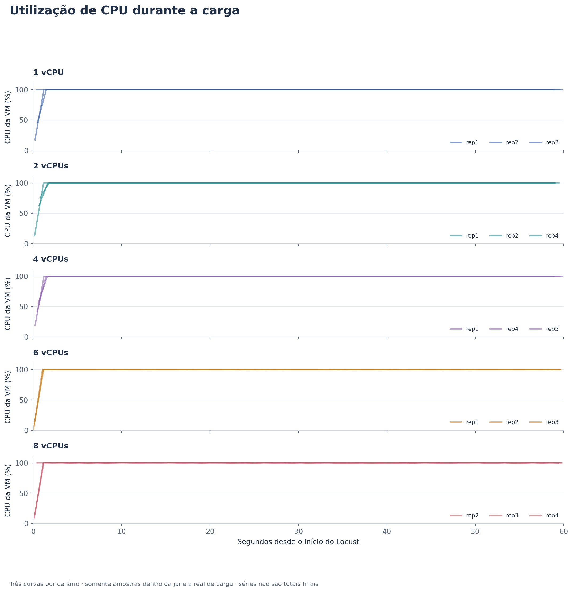
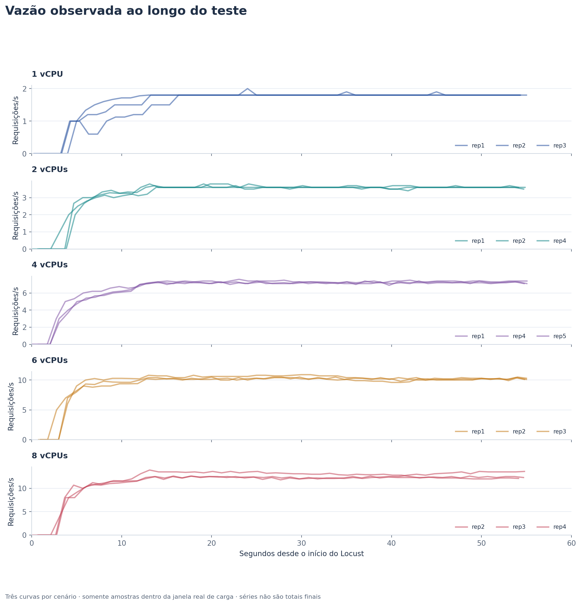
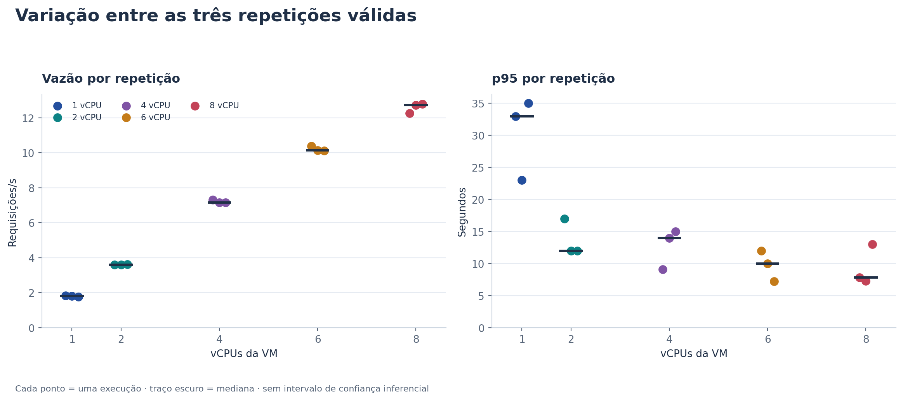
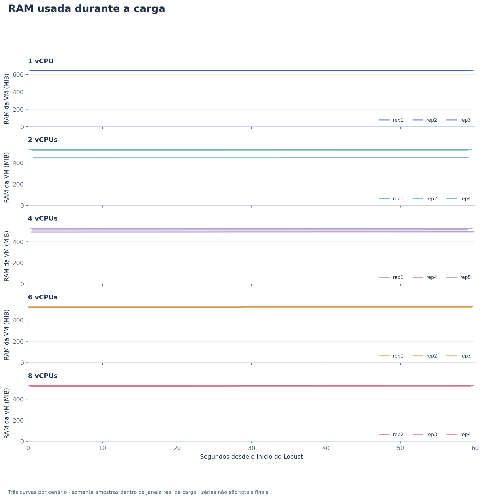
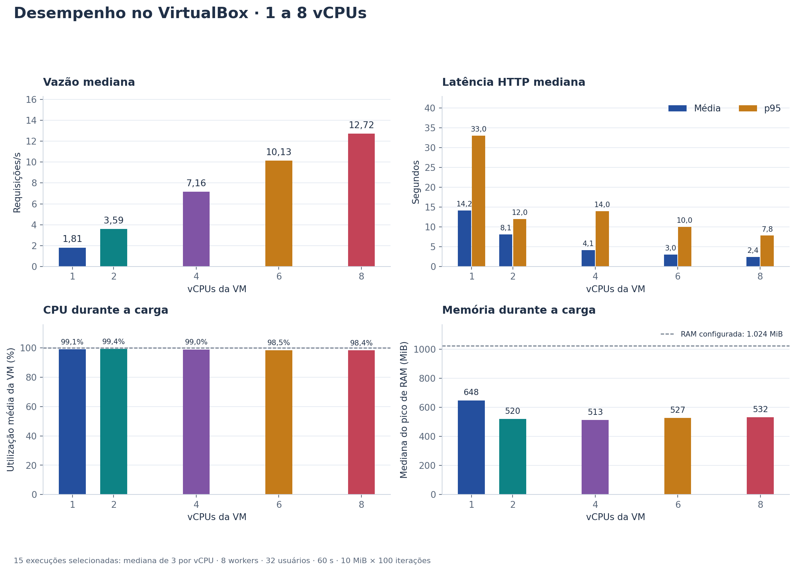
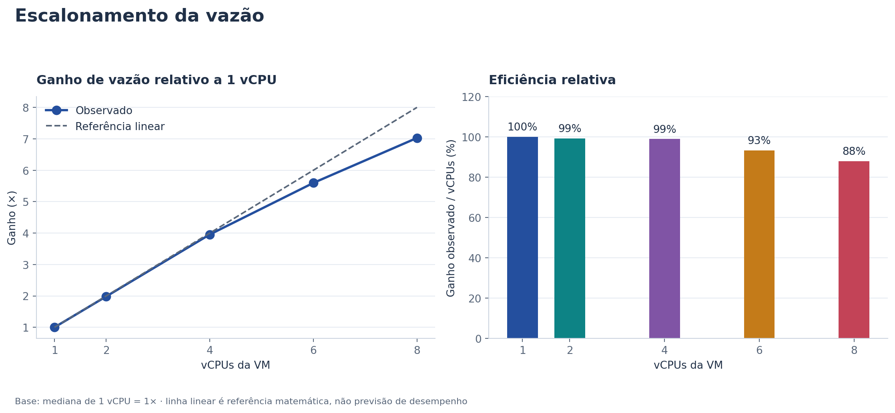

# Relatório técnico — aplicação CPU-bound

**Estudo:** serviço de hashing SHA-256 e avaliação de provisionamento de CPU em máquinas virtuais VirtualBox. **Data dos registros experimentais:** 13 de outubro de 2026. Este documento reúne o relatório acadêmico e o procedimento de reprodução. Abrange somente a aplicação CPU-bound.

## 1. Introdução

A atividade investiga como o provisionamento de recursos de uma máquina virtual afeta o desempenho de uma aplicação submetida a carga. A análise conjunta de utilização de recursos, vazão e tempo de resposta permite distinguir uma melhoria de capacidade de uma mera mudança no número de processadores atribuídos. Para estudar esse efeito, foi desenvolvido um serviço HTTP que executa hashing SHA-256 repetido, uma carga sintética com trabalho computacional parametrizável e pouca entrada/saída durante o cálculo.

O objetivo geral é caracterizar o comportamento desse serviço sob carga e comparar cenários de provisionamento de CPU no VirtualBox. Especificamente, busca-se: (i) implementar e validar uma carga reproduzível; (ii) registrar o ambiente e o procedimento de medição; (iii) comparar utilização de CPU e memória, vazão, latência e falhas HTTP; e (iv) avaliar os limites das inferências possíveis a partir dos dados coletados. Os resultados são apresentados na Seção 5, sem pressupor que CPU elevada, isoladamente, determine um limiar de saturação.

## 2. Desenvolvimento da aplicação

O serviço utiliza Python, FastAPI, Pydantic, Uvicorn e a implementação de SHA-256 de `hashlib`. O núcleo de hashing está em [`app/hashing.py`](../app/hashing.py); [`app/main.py`](../app/main.py) expõe os endpoints; [`app/schemas.py`](../app/schemas.py) valida os dados; [`app/limits.py`](../app/limits.py) controla o tamanho dos corpos HTTP e a concorrência admitida por worker. O gerador de carga ([`load_tests/locustfile.py`](../load_tests/locustfile.py)) e o monitor ([`scripts/monitor.py`](../scripts/monitor.py)) são processos separados da API.

```text
Hospedeiro: Locust (usuários virtuais) ── TCP 127.0.0.1:8000 / NAT ──► VM Ubuntu
                                                                    Uvicorn (8 workers)
                                                                         │
                                                            FastAPI → SHA-256 em memória
                                                                         │
                                                    monitor.py + vmstat (CPU, RAM, swap)
Hospedeiro: SSH 127.0.0.1:2222 ─────────────── NAT TCP ───────────────► VM:22
```

**Figura 1 — Arquitetura experimental.** As setas indicam o caminho das requisições e do acesso administrativo; os comandos de carga rodam no hospedeiro, enquanto API e coleta de recursos rodam na VM. As portas são TCP.

| Endpoint | Método e entrada | Função e saída principal |
| --- | --- | --- |
| `/health` | `GET`, sem corpo | Informa disponibilidade com `{"status":"ok"}`. |
| `/hash` | `POST`, arquivo multipart | Calcula SHA-256 do arquivo em blocos e retorna nome, tamanho, digest e tempo de execução. |
| `/verify` | `POST`, arquivo e digest hexadecimal esperado | Calcula SHA-256 e retorna o digest calculado, o esperado e o resultado da comparação. |
| `/benchmark` | `POST`, JSON com `data_size_mb` e `iterations` | Executa hashing repetido de um buffer determinístico e informa digest agregado, volume processado e tempos de preparação/execução. |

**Tabela 1 — Endpoints HTTP da aplicação.** Fonte: [`app/main.py`](../app/main.py) e modelos em [`app/schemas.py`](../app/schemas.py).

No `/benchmark`, o buffer é construído em memória pela repetição da sequência de bytes de 0 a 255 até o tamanho solicitado. Em cada iteração é calculado um novo SHA-256 do **mesmo buffer inteiro**; os digests binários são incorporados a um hash agregador que produz o resultado final. O serviço informa separadamente o tempo de preparar o buffer e o tempo do laço de hashing. Os parâmetros controlam o trabalho: `data_size_mb × iterations` expressa o volume lógico processado, não a quantidade de RAM simultaneamente alocada. No perfil experimental, 10 MiB × 100 iterações correspondem a 1.000 MiB processados logicamente por requisição. O buffer não é lido de disco durante o laço, e não há escrita de arquivo por requisição. Trata-se de uma **carga sintética**, não de uma aplicação de produção com arquivos reais ou uma simulação integral de I/O.

Os endpoints de arquivo leem blocos de 64 KiB e limitam o upload a 16 MiB. O digest esperado em `/verify` deve ter 64 caracteres hexadecimais e a comparação emprega `hmac.compare_digest`; isso compara os valores, mas não autentica a origem do digest esperado. Para `/benchmark`, o esquema exige inteiros estritos, 1–32 MiB, 1–1.000 iterações e produto de no máximo 8.192 MiB. O middleware limita o corpo a 17 MiB nos endpoints multipart, a 4 KiB nos demais e a oito requisições admitidas simultaneamente **por worker**; tamanhos excessivos são rejeitados com HTTP 413 e excesso de concorrência pode gerar HTTP 503. Restrições de esquema produzem erro de validação. Esses limites reduzem o risco de consumo descontrolado de recursos, mas a presença de oito workers não torna ilimitada a capacidade da VM.

Os testes automatizados cobrem os quatro endpoints, digest conhecido, determinismo do benchmark, processamento integral do buffer, validações, fronteiras de upload e limites do corpo HTTP ([`tests/test_api.py`](../tests/test_api.py), [`tests/test_hashing.py`](../tests/test_hashing.py)). O roteiro experimental registra **34 testes da aplicação aprovados e um aviso de depreciação** na VM de 1 vCPU; essa contagem se refere à suíte disponível naquele clone, não aos testes de análise acrescentados no hospedeiro posteriormente. [PENDENTE: captura ou log persistido da execução de `pytest` dentro da VM para evidência visual independente da contagem.] A captura abaixo comprova a API acessível pelo encaminhamento NAT, mas não substitui a evidência da suíte.


**Figura 2 — API em funcionamento.** A resposta de `/health` contém `status: ok`; `/benchmark` apresenta o algoritmo, os parâmetros 10 MiB e 100 iterações, o total lógico de 1.000 MiB, o tempo de execução e o digest. O tempo da chamada isolada exibida não é a latência HTTP sob a carga concorrente do Locust.

## 3. Ambiente experimental

Os artefatos documentam cinco configurações VirtualBox: 1, 2, 4, 6 e 8 vCPUs. Em todas, a memória atribuída foi de 1.024 MiB e a API foi iniciada com oito workers Uvicorn. A VM `cpu_Bound`, de 1 vCPU, foi criada separadamente a partir da mesma imagem-base usada na cadeia dos cenários de 2–8 vCPUs. Por isso, o contraste 1 versus 2–8 vCPUs não é uma comparação dentro da mesma instância de VM. Os inventários de 2–8 vCPUs identificam Ubuntu Server 22.04.5 LTS, kernel 5.15.0-198-generic, Python 3.10.12 e o modelo de CPU **apresentado ao convidado** como AMD Ryzen 5 5500; esse último registro não comprova, por si só, o modelo físico do hospedeiro.

| Componente | Configuração comprovada | Evidência |
| --- | --- | --- |
| Sistema hospedeiro | [PENDENTE: sistema operacional e versão do hospedeiro.] | Não há inventário do hospedeiro no repositório. |
| Processador físico e RAM do hospedeiro | [PENDENTE: modelo, núcleos/threads e memória física do hospedeiro.] | Inventários dentro da VM não identificam de forma independente o hardware físico. |
| VirtualBox no hospedeiro | VirtualBox; [PENDENTE: versão instalada.] | Capturas de criação e redirecionamento de portas; versão não registrada. |
| Sistema convidado | Ubuntu Server 22.04.5 LTS; kernel 5.15.0-198-generic nos inventários de 2–8 vCPUs. | [`inventory.txt` de 2 vCPUs](../results/vbox-2cpu-20261013T140512Z/inventory.txt) e inventários dos demais cenários. |
| vCPUs e RAM da VM | 1, 2, 4, 6 ou 8 vCPUs; 1.024 MiB atribuídos. | Captura de configuração de 1 vCPU, `nproc` na VM e inventários/arquivos de resultados. |
| Python na VM | 3.10.12 nos inventários de 2–8 vCPUs; [PENDENTE: registro persistido da versão Python na VM de 1 vCPU.] | Inventários dos cenários de 2–8 vCPUs. |
| API | FastAPI 0.115.14, Uvicorn 0.34.3, Pydantic 2.11.7; oito workers. | [`requirements.txt`](../requirements.txt), inventários e registros de deploy. |
| Gerador externo | Locust 2.37.14 em Python 3.12.3, no hospedeiro, fixado à CPU lógica 0. | `config.txt` e `dependencies.txt` das repetições; roteiro de execução. |

**Tabela 2 — Infraestrutura conhecida e lacunas de inventário.** Os registros do convidado e do gerador estão separados para não atribuir à máquina física características observadas dentro da VM.

A criação da VM utilizou o VDI fornecido para a atividade, selecionado na interface do VirtualBox. As capturas registram 1 vCPU e 1.024 MiB para a VM de demonstração, além das regras NAT TCP `127.0.0.1:2222 → VM:22` (SSH) e `127.0.0.1:8000 → VM:8000` (API). O VDI e as capturas documentam o procedimento; [PENDENTE: captura da configuração final de vCPU/RAM de cada uma das VMs de 2, 4, 6 e 8 vCPUs, caso seja exigida evidência visual individual.] Os inventários textuais registram as contagens de vCPU desses cenários.


**Figura 3 — Configuração da VM de 1 vCPU.** A interface mostra 1 processador e 1.024 MiB; trata-se da etapa de criação, complementada pela conferência dentro do sistema convidado na Figura 6.


**Figura 4 — Disco da VM.** A captura mostra a seleção do VDI disponibilizado para a atividade; ela não comprova, isoladamente, que a VM já iniciou ou que os testes rodaram.


**Figura 5 — Encaminhamento de portas NAT.** As regras permitem acessar SSH pela porta 2222 e a API pela 8000 no loopback do hospedeiro; não expõem esses serviços para outras interfaces por essa configuração.


**Figura 6 — Conferência dentro da VM de 1 vCPU.** O prompt `osboxes@osboxes`, `nproc=1` e `free -m` registram a instância efetivamente iniciada. A captura foi feita após a bateria e mostra 26 MiB de swap ocupado naquele instante; a análise de swap **durante** os testes usa os arquivos `vmstat`, não essa imagem.

O código foi clonado por HTTPS na branch `cpu-bound`, commit registrado `41f0bec`, para `/home/osboxes/atividade-2-git/cpu-bound` na VM de 1 vCPU. O serviço foi iniciado em `0.0.0.0:8000`, com oito workers e sem access log. Os detalhes operacionais, inclusive instalação, testes e acesso SSH, constam no Apêndice A. A Figura 2 comprova o deploy acessível do hospedeiro. [PENDENTE: captura explícita dos oito workers em execução ou do comando de inicialização na VM, se a disciplina exigir evidência visual além dos registros textuais.]

## 4. Metodologia experimental

O experimento variou a quantidade de vCPUs atribuídas à VM e manteve fixos a RAM, o número de workers, o payload e o perfil do gerador. O Locust executou fora da VM, no hospedeiro. Cada usuário virtual realizou `POST /benchmark`, aguardou a resposta e iniciou outra solicitação sem espera adicional; portanto, o modelo é **fechado**, com 32 usuários concorrentes configurados, e a taxa de chegada observada depende do tempo de resposta. O script de carga exige resposta HTTP 200 e confere campos essenciais do JSON. Antes das medições, o roteiro registra um aquecimento de 32 chamadas com respostas 200 na VM de 1 vCPU.

| Item | Configuração |
| --- | --- |
| Endpoint e corpo | `POST /benchmark`, `{"data_size_mb":10,"iterations":100}`. |
| Trabalho lógico | 1.000 MiB de dados submetidos a SHA-256 por requisição; buffer residente de 10 MiB. |
| Usuários e subida | 32 usuários; subida de 32 usuários/s; espera adicional de 0 s. |
| Duração | 60 s por execução do Locust; timeout HTTP de 120 s no cliente. |
| Repetições | Três selecionadas por configuração; 19 arquivos de execução preservados no total, 15 selecionados. |
| Recursos e servidor | 1.024 MiB de RAM; oito workers Uvicorn; vCPUs variáveis. |
| Local da carga | Hospedeiro; Locust 2.37.14, fixado na CPU lógica 0 com `taskset`. |
| Coleta na VM | `monitor.py` com amostras próximas de 1 s e `vmstat -n 1`; coleta iniciada antes do Locust e encerrada depois. |

**Tabela 3 — Parâmetros do ensaio comparativo.** Fonte: `config.txt` de cada repetição selecionada e scripts de carga/monitoramento.

| Cenário | VM e origem | Repetições selecionadas | Excluídas do resumo |
| ---: | --- | --- | --- |
| 1 vCPU | `cpu_Bound`, VM separada da mesma imagem-base | 1, 2, 3 | Nenhuma. |
| 2 vCPUs | Cadeia `cpu__bound_2cpu` | 1, 2, 4 | 3: monitor terminou 7 s antes da carga. |
| 4 vCPUs | Mesma cadeia | 1, 4, 5 | 2: monitor terminou 5 s antes; 3: sem sobreposição. |
| 6 vCPUs | Mesma cadeia | 1, 2, 3 | Nenhuma. |
| 8 vCPUs | Mesma cadeia | 2, 3, 4 | 1: sem sobreposição. |

**Tabela 4 — Cenários e auditoria das repetições.** Fonte: [`auditoria.csv`](../results/virtualbox-graficos/auditoria.csv) e diretórios `results/vbox-*`.

A variável independente principal foi a quantidade de vCPUs. As variáveis dependentes foram utilização agregada de CPU da VM, memória usada, vazão em requisições por segundo, latência HTTP média e p95, quantidade de respostas e falhas. RAM, workers, parâmetros do benchmark, número de usuários, taxa de subida, duração e espera foram controlados por configuração. O estado físico do hospedeiro, temperatura, frequência efetiva e competição por recursos **não** foram medidos como variáveis controladas. A ordem 2 → 4 → 6 → 8 vCPUs não foi randomizada; 1 vCPU foi medido posteriormente em outra VM.

| Métrica | Fonte e tratamento | Unidade/interpretação |
| --- | --- | --- |
| CPU da VM | `system_cpu_percent` de `repN-monitor.csv`, média das amostras dentro da janela real da carga; mediana das médias de três repetições. | %, agregado de todas as vCPUs da VM na escala 0–100; não é soma dos percentuais dos workers. |
| RAM | `ram_used_bytes` do monitor; máximo dentro da janela em cada repetição e mediana dos três máximos. | MiB usados pela VM inteira, não apenas RSS da API. |
| Vazão e latência média | Resumo final de `locust.log` por repetição; mediana entre três repetições. | req/s e ms de resposta HTTP. |
| p95 | Percentil aproximado final do Locust por repetição; mediana dos três p95, não percentil combinado. | ms; cerca de 95% das respostas de cada execução ficam nesse limite ou abaixo. |
| Falhas | Contagem final do Locust, inclusive respostas classificadas como inconsistentes pelo script. | número de requisições com falha. |
| Swap | `repN-vmstat.txt`; despreza-se a primeira linha numérica, média desde o boot. | KiB alocados e entrada/saída de swap durante a coleta. |

**Tabela 5 — Métricas, fontes e unidades.** CPU e RAM são métricas da VM; latência e vazão são métricas HTTP observadas pelo Locust.

As janelas efetivas são os horários de início e encerramento em `locust.log`, convertidos do horário local do hospedeiro para UTC. Apenas amostras do monitor dentro dessas janelas entram nas médias de CPU e máximos de RAM. As 15 repetições selecionadas têm de 58 a 60 amostras coincidentes; as quatro demais foram preservadas e identificadas em [`auditoria.csv`](../results/virtualbox-graficos/auditoria.csv), mas não sustentam inferências de recurso durante a carga. As métricas finais HTTP vêm do log, pois o último CSV periódico pode anteceder o resumo de encerramento. Os dados por repetição e as regras de análise estão em [`repeticoes.csv`](../results/virtualbox-graficos/repeticoes.csv) e [`scripts/virtualbox_analysis.py`](../scripts/virtualbox_analysis.py).

## 5. Resultados e discussão

Todos os valores centrais da Tabela 6 são medianas das **três repetições selecionadas** de cada cenário, não estatísticas calculadas sobre uma única reunião de respostas. A vazão e a latência média vêm dos resumos finais do Locust; a CPU é a mediana das médias temporais e a RAM é a mediana dos máximos amostrados. O p95 é aproximado pelo Locust. O [resumo derivado dos dados experimentais](../results/virtualbox-graficos/resumo_por_cpu.csv) permite conferir os números, e os arquivos individuais continuam em [`results/vbox-*`](../results/).

| vCPUs | Requisições nas três repetições | Falhas | Vazão (req/s) | Latência média (ms) | p95 (ms) | CPU da VM (%) | Pico de RAM (MiB) |
| ---: | ---: | ---: | ---: | ---: | ---: | ---: | ---: |
| 1 | 321 | 0 | 1,81 | 14.162 | 33.000 | 99,1 | 647,9 |
| 2 | 642 | 0 | 3,59 | 8.126 | 12.000 | 99,4 | 520,2 |
| 4 | 1.292 | 0 | 7,16 | 4.098 | 14.000 | 99,0 | 512,8 |
| 6 | 1.827 | 0 | 10,13 | 3.016 | 10.000 | 98,5 | 526,5 |
| 8 | 2.260 | 0 | 12,72 | 2.419 | 7.800 | 98,4 | 531,8 |

**Tabela 6 — Resultados comparativos do VirtualBox.** As 15 repetições selecionadas totalizam 6.342 requisições sem falhas registradas. As contagens são somas; as demais colunas numéricas de desempenho/recurso são medianas entre repetições. Fonte: [`repeticoes.csv`](../results/virtualbox-graficos/repeticoes.csv) e [`resumo_por_cpu.csv`](../results/virtualbox-graficos/resumo_por_cpu.csv).

### 5.1. Utilização de CPU



**Figura 7 — CPU durante a carga.** Eixo horizontal: segundos desde o início do Locust; eixo vertical: utilização agregada da CPU da VM, em %. Os cinco painéis representam as quantidades de vCPU; as três curvas de cada painel são as repetições selecionadas.

Após a subida inicial da carga, a utilização se mantém próxima do teto da escala em todos os cenários. As medianas das médias temporais variam de 98,4% a 99,4%. Como o percentual agrega todas as vCPUs da VM em uma escala de 0 a 100%, 99% em 8 vCPUs representa uma quantidade maior de trabalho computacional simultâneo do que 99% em 1 vCPU. O gráfico mostra pressão contínua de CPU sob **essa carga fixa**, mas, isoladamente, não localiza a demanda exata em que a capacidade passa a ser insuficiente.

### 5.2. Vazão



**Figura 8 — Vazão observada ao longo do teste.** Eixo horizontal: segundos desde o início do Locust; eixo vertical: requisições concluídas por segundo (req/s). Os painéis distinguem 1, 2, 4, 6 e 8 vCPUs; cada painel apresenta três repetições.

Depois da subida dos 32 usuários, as curvas se aproximam de faixas características de cada cenário. A vazão mediana final aumenta de 1,81 req/s em 1 vCPU para 3,59, 7,16, 10,13 e 12,72 req/s em 2, 4, 6 e 8 vCPUs. A evolução temporal permite observar a aproximação a um patamar em cada execução, mas os valores comparativos vêm do resumo final de `locust.log`, e não de um ponto isolado do CSV histórico. Como os usuários esperam a resposta anterior antes de iniciar outra solicitação, a taxa realizada não é uma taxa de chegada independente do servidor.

### 5.3. Latência e dispersão entre repetições



**Figura 9 — Variação entre repetições.** Eixo horizontal: vCPUs da VM; eixo vertical do painel superior: vazão em req/s; eixo vertical do inferior: p95 em segundos. Cada ponto é uma repetição selecionada e o traço indica a mediana do grupo.

A latência média mediana cai de 14.162 ms em 1 vCPU para 2.419 ms em 8 vCPUs, uma redução de aproximadamente 82,9% no perfil medido. A mediana do p95 cai de 33.000 para 7.800 ms, mas não diminui estritamente a cada aumento de vCPU: 4 vCPUs apresentaram 14.000 ms, acima dos 12.000 ms de 2 vCPUs. Os pontos revelam variação importante de cauda; por exemplo, as três repetições selecionadas de 8 vCPUs tiveram p95 de 7.800, 7.300 e 13.000 ms. Assim, a tendência de queda da latência média é mais regular que a do p95. Três repetições descrevem a dispersão observada, mas não fundamentam um intervalo de confiança nem uma afirmação de diferença estatística.

### 5.4. Consumo de memória



**Figura 10 — RAM usada durante a carga.** Eixo horizontal: segundos desde o início do Locust; eixo vertical: memória usada pela VM em MiB. Cada painel representa uma configuração de vCPU e cada curva, uma repetição selecionada.

A memória usada pela VM permaneceu relativamente estável ao longo de cada minuto. A mediana dos picos foi de 647,9 MiB em 1 vCPU e de 512,8 a 531,8 MiB em 2–8 vCPUs, abaixo dos 1.024 MiB atribuídos. Essa métrica inclui processos e caches do sistema convidado; portanto, a diferença entre 1 vCPU e os demais cenários não pode ser atribuída apenas à aplicação ou ao número de vCPUs, sobretudo porque o primeiro foi medido em outra VM. Nos `repN-vmstat.txt`, os cenários de 2–8 vCPUs apresentam `swpd=0`; na VM de 1 vCPU havia cerca de 524 KiB de swap alocado durante os testes, com `si=0` e `so=0`, sem entrada/saída de swap registrada na coleta. O valor de 26 MiB mostrado na Figura 6 pertence a um instante posterior e não altera essa leitura.

### 5.5. Saturação e curva de demanda

A combinação de CPU quase integralmente ocupada, vazão em faixas relativamente estáveis ao longo dos 60 s e tempos de resposta de vários segundos é **compatível** com forte restrição de processamento para 32 usuários e 10 MiB × 100 iterações por chamada. Porém, a instrumentação não mediu profundidade de fila nem uso do gerador de carga em cada repetição, e o modelo fechado do Locust reduz a taxa de novas solicitações quando as respostas demoram. As contagens de falhas foram zero, o que mostra sucesso das solicitações concluídas, não ausência de espera ou reserva de capacidade.

**[PENDENTE: realizar ou recuperar, no VirtualBox, execuções com diferentes níveis de usuários simultâneos, mantendo vCPUs, RAM, workers e payload fixos, para construir uma curva de demanda e estimar o ponto de saturação.]** Os arquivos oficiais disponíveis variam vCPUs com **32 usuários fixos**. A Figura 8 é uma série temporal de vazão sob uma única demanda configurada, não uma curva vazão × usuários. Há apenas um registro isolado de configuração para 10 usuários em `results/run-20261013T145841-27630`, sem resultados suficientes para inclusão. O piloto preliminar em Docker foi retirado do projeto a pedido do grupo; seus dados brutos e gráficos não estão disponíveis e não substituem medições exigidas na VM.

### 5.6. Efeito do provisionamento e escalabilidade



**Figura 11 — Comparação dos cinco provisionamentos.** Eixo horizontal de todos os painéis: vCPUs da VM. Eixos verticais: vazão mediana em req/s, latência média e p95 em segundos, utilização média de CPU da VM em % e mediana do pico de RAM em MiB. A linha de 1.024 MiB no painel de RAM indica a memória atribuída, não um limiar medido de falha.

Com a mesma demanda configurada, acrescentar vCPUs elevou a vazão e reduziu a latência média, ao mesmo tempo que a CPU permaneceu quase integralmente ocupada. Isso é coerente com mais trabalho SHA-256 processado em paralelo pelos oito workers. O ganho de 8 vCPUs sobre 1 vCPU foi de 12,72/1,81 ≈ **7,03×** em vazão. A comparação deve ser lida como indicativa do efeito do provisionamento neste arranjo: 1 vCPU veio de outra VM, os testes ocorreram em sequência não randomizada e não há monitoramento suficiente do hospedeiro para isolar outras influências.



**Figura 12 — Speedup e eficiência relativa.** Eixo horizontal: vCPUs da VM; eixo vertical superior: ganho de vazão relativo a 1 vCPU (×); eixo vertical inferior: ganho observado dividido pelo número de vCPUs (%). A linha de ganho linear é apenas referência matemática, não previsão de desempenho.

Se `R_n` é a vazão mediana do cenário de `n` vCPUs, então `speedup_n = R_n/R_1` e `eficiência_n = 100 × R_n/(n × R_1)`. Aplicando essas definições às medianas observadas:

| vCPUs | Speedup relativo a 1 vCPU | Eficiência relativa |
| ---: | ---: | ---: |
| 1 | 1,00× | 100,0% |
| 2 | 1,98× | 99,2% |
| 4 | 3,96× | 98,9% |
| 6 | 5,60× | 93,3% |
| 8 | 7,03× | 87,8% |

**Tabela 7 — Escalabilidade de vazão.** Os quocientes usam valores arredondados a duas casas do [`resumo_por_cpu.csv`](../results/virtualbox-graficos/resumo_por_cpu.csv); pequenas diferenças de décimos podem surgir do arredondamento. A queda da eficiência relativa em 6 e 8 vCPUs pode refletir custos de escalonamento, comunicação, recursos compartilhados ou condições do hospedeiro, mas os dados não permitem repartir causalmente essas parcelas.

## 6. Limitações dos experimentos

Os resultados representam uma VM virtualizada sobre recursos físicos compartilhados, com possíveis oscilações de escalonamento, frequência e competição do hospedeiro que não foram monitoradas. O inventário do convidado expõe um modelo de CPU, mas faltam os dados físicos e a versão do VirtualBox do hospedeiro; a VM de 1 vCPU foi criada separadamente. Além disso, a sequência 2 → 4 → 6 → 8 vCPUs não foi randomizada. Esses fatores limitam a atribuição de toda a diferença observada exclusivamente ao número de vCPUs.

Cada repetição durou 60 s e cada cenário contribuiu com três repetições selecionadas. Isso é suficiente para descrever o comportamento medido, mas não para avaliar efeitos de longo prazo, sazonalidade térmica ou variabilidade com precisão estatística. Quatro execuções adicionais tiveram monitoramento parcial ou sem sobreposição e foram excluídas do resumo; os dados HTTP permaneceram preservados para auditoria. As janelas de CPU e RAM incluem quase todo o minuto (58–60 amostras), mas o início exato e o fim entre amostras não são observados continuamente. Fixar o Locust à CPU lógica 0 não comprova que a VM nunca tenha disputado essa CPU física; não há telemetria do hospedeiro durante cada ensaio para quantificar essa interação.

O número fixo de oito workers, inclusive em 1 vCPU, controla uma variável importante, porém implica contenção e custo de processos diferente conforme o provisionamento. A carga SHA-256 usa dados determinísticos residentes em memória; ela não representa a mistura de operações, cache, disco ou rede de um serviço real. Os 32 usuários do Locust formam uma carga fechada, não uma chegada externa com taxa independente. Sem uma varredura de usuários, filas medidas e telemetria do gerador, a identificação do ponto de saturação permanece pendente. Os tempos HTTP incluem transporte e espera, ao passo que `execution_time_ms` da API mede apenas o laço de hashing; compará-los como se fossem a mesma medida produziria interpretação incorreta.

## 7. Conclusão

O serviço CPU-bound foi implementado com hashing SHA-256 parametrizado, limites de entrada e testes automatizados, e foi medido no VirtualBox em **cinco cenários** de 1, 2, 4, 6 e 8 vCPUs, com 1.024 MiB de RAM, oito workers e 32 usuários fixos. A análise utilizou 15 execuções selecionadas de 19 preservadas. Nessas 15, foram registradas 6.342 requisições sem falhas HTTP.

Sob o perfil de 10 MiB × 100 iterações, a vazão mediana cresceu de **1,81 para 12,72 req/s** e a latência média mediana caiu de **14,16 para 2,42 s** entre 1 e 8 vCPUs. O ganho de vazão foi **7,03×**, com eficiência relativa aproximada de **87,8%** em 8 vCPUs. A utilização média agregada de CPU ficou entre **98,4% e 99,4%**; a mediana dos picos de RAM permaneceu abaixo dos 1.024 MiB atribuídos. Os dados sustentam que, nesse perfil e nas condições observadas, aumentar vCPUs elevou a capacidade e diminuiu a latência média, enquanto a CPU continuou sob forte pressão. Não sustentam uma localização quantitativa do ponto de saturação por demanda, pois os ensaios oficiais não variaram o número de usuários. A procedência da VM de 1 vCPU e a ausência de telemetria do hospedeiro limitam a interpretação causal do speedup.

## Apêndice A — Reprodução da VM e dos testes

Este roteiro consolida a execução documentada para a VM `cpu_Bound` de 1 vCPU e o procedimento aplicado aos demais provisionamentos. **VM** e **hospedeiro** são identificados em cada etapa. Os caminhos `NOVA-EXECUCAO` são exemplos para uma medição futura: escolha um nome ainda inexistente, pois o script de carga recusa sobrescrever resultados. Os comandos abaixo documentam o método; sua publicação aqui **não** significa que novos testes ou transferências foram executados durante a elaboração deste relatório.

### A.1. Criar a VM, habilitar SSH e verificar recursos

No VirtualBox, crie uma VM Ubuntu Server 22.04 usando o VDI da atividade, 1 vCPU, 1.024 MiB de RAM e adaptador NAT. Configure no redirecionamento de portas as regras TCP `127.0.0.1:2222 → 22` e `127.0.0.1:8000 → 8000`, como nas Figuras 3–5.

Caso o serviço SSH não esteja instalado, execute **no console da VM**:

```bash
sudo apt update
sudo apt install -y openssh-server
sudo systemctl enable --now ssh
sudo systemctl status ssh
```

No **hospedeiro**, confira a configuração e entre na VM:

```bash
VBoxManage showvminfo cpu_Bound --machinereadable
ssh -p 2222 osboxes@127.0.0.1
```

Depois do login, execute **na VM**:

```bash
whoami
hostname
nproc
free -m
```

O registro de 1 vCPU mostrou usuário e hostname `osboxes`, `nproc=1` e cerca de 957 MiB de memória visível ao sistema convidado (Figura 6). O valor visível pode ser menor que os 1.024 MiB atribuídos pela interface do VirtualBox. Para evidência, registre a tela de configuração da VM e o terminal com `nproc`/`free -m`; a captura já existente é a Figura 6.

### A.2. Clonar a branch correta dentro da VM e validar a instalação

O repositório foi clonado **dentro da VM** por HTTPS; não é necessária chave SSH do GitHub para essa etapa:

```bash
cd /home/osboxes
git clone --branch cpu-bound --single-branch \
  https://github.com/POI-2026-2-grupo15/atividade-2.git atividade-2-git
cd atividade-2-git
git branch --show-current
git rev-parse --short HEAD
cd cpu-bound
python3 -m venv .venv
.venv/bin/python -m pip install -r requirements.txt
.venv/bin/python -m pip check
.venv/bin/python -m pytest -q
```

A branch é `cpu-bound`, com hífen. A execução documentada estava no commit `41f0bec`; em um clone posterior, confira a revisão antes de comparar novos números. A instalação registrou `No broken requirements found` e a suíte da aplicação passou com 34 testes e um aviso de depreciação. Não há captura persistida dessa saída; [PENDENTE: registrar print ou log de `pytest` na VM se exigido como evidência.] Não sobrescreva `atividade-2-git` se a pasta já existir: confira a cópia com `git remote -v`, `git branch --show-current` e `git rev-parse --short HEAD` ou escolha outro destino.

### A.3. Iniciar a API e conferir as respostas

Em **um terminal da VM**, inicie o Uvicorn com o mesmo número de workers em todos os cenários. Use uma pasta de saída nova; se a porta 8000 já estiver ocupada, verifique a instância existente antes de tentar iniciar outra:

```bash
cd ~/atividade-2-git/cpu-bound
mkdir results/NOVA-EXECUCAO-1CPU
.venv/bin/python -m uvicorn app.main:app --host 0.0.0.0 \
  --port 8000 --workers 8 --no-access-log \
  > results/NOVA-EXECUCAO-1CPU/api.log 2>&1 &
APP_PID=$!
printf '%s\n' "$APP_PID" > results/NOVA-EXECUCAO-1CPU/api.pid
tail -n 12 results/NOVA-EXECUCAO-1CPU/api.log
```

O PID salvo identifica o processo mestre usado pelo monitor. Na execução documentada, `api.log` e `api.pid` ficaram em `results/vbox-1cpu-20261013T2036Z/`. Em **outro terminal no hospedeiro**, com `jq` instalado, consulte a API pela porta redirecionada:

```bash
curl --silent --show-error http://127.0.0.1:8000/health | jq .
curl --silent --show-error -H 'Content-Type: application/json' \
  -d '{"data_size_mb":10,"iterations":100}' \
  http://127.0.0.1:8000/benchmark | jq .
```

A Figura 2 mostra as saídas reais: `status: ok` confirma o acesso HTTP; `algorithm: sha256`, `data_size_mb`, `iterations`, `total_processed_mb` e `digest` identificam o trabalho executado. `preparation_time_ms` e `execution_time_ms` são tempos internos da API. A latência observada pelo Locust inclui também transporte e espera sob concorrência. Para os prints, priorize a resposta formatada, não comandos de instalação sem saída relevante.

### A.4. Aquecer, monitorar e executar três repetições

O **hospedeiro** gera a carga; a **VM** hospeda a API, `monitor.py` e `vmstat`. Antes da primeira repetição de um cenário, o aquecimento documentado foi:

```bash
seq 32 | xargs -P 8 -I{} curl --silent --show-error --max-time 120 \
  -o /dev/null -w '%{http_code}\n' \
  -H 'Content-Type: application/json' \
  -d '{"data_size_mb":10,"iterations":100}' \
  http://127.0.0.1:8000/benchmark | sort | uniq -c
```

Foram obtidas 32 respostas HTTP 200 na VM de 1 vCPU. Para **cada repetição**, inicie primeiro o monitor **na VM**; o exemplo usa `rep1`:

```bash
cd ~/atividade-2-git/cpu-bound
APP_PID=$(cat results/NOVA-EXECUCAO-1CPU/api.pid)
.venv/bin/python scripts/monitor.py --pid "$APP_PID" --interval 1 \
  --output results/NOVA-EXECUCAO-1CPU/rep1-monitor.csv &
MONITOR_PID=$!
vmstat -n 1 600 > results/NOVA-EXECUCAO-1CPU/rep1-vmstat.txt &
VMSTAT_PID=$!
```

No **hospedeiro**, use o projeto no mesmo commit e um ambiente Python que contenha Locust. Se ainda não houver clone local, prepare uma pasta nova:

```bash
git clone --branch cpu-bound --single-branch \
  https://github.com/POI-2026-2-grupo15/atividade-2.git atividade-2-local
cd atividade-2-local/cpu-bound
python3 -m venv .venv
.venv/bin/python -m pip install -r requirements.txt
```

Depois, ainda **no hospedeiro**, execute a carga de 60 s:

```bash
source .venv/bin/activate
USERS=32 SPAWN_RATE=32 DURATION=60s DATA_SIZE_MB=10 ITERATIONS=100 \
  WAIT_SECONDS=0 HOST=http://127.0.0.1:8000 \
  OUTPUT_DIR=results/NOVA-EXECUCAO-1CPU/rep1 \
  taskset -c 0 bash scripts/run_load_test.sh
```

Somente **depois** de o Locust terminar, pare a coleta **na VM**:

```bash
kill -TERM "$MONITOR_PID" "$VMSTAT_PID"
```

Repita o ciclo monitor → Locust → encerramento do monitor para `rep2` e `rep3`, trocando os nomes dos arquivos e diretórios. Não reaproveite `OUTPUT_DIR`. O script grava `config.txt`, `dependencies.txt`, `locust.log` e CSVs detalhados em cada pasta `repN`; os arquivos `repN-monitor.csv` e `repN-vmstat.txt` ficam na pasta do cenário. O monitor deve cobrir toda a janela do Locust — quatro execuções históricas não satisfizeram esse critério e por isso não entram na Tabela 6.

Durante uma rodada **extra de demonstração**, com os mesmos parâmetros e fora das três repetições oficiais, foram capturadas as Figuras 13–15. Ela está em [`results/print-live-1cpu`](../results/print-live-1cpu/) e serve apenas de evidência visual. Para reproduzir essa demonstração, abra `top -o %CPU` **na VM** e rode **no hospedeiro** em uma pasta nova:

```bash
mkdir results/NOVA-CAPTURA-1CPU
DATA_SIZE_MB=10 ITERATIONS=100 WAIT_SECONDS=0 \
taskset -c 0 .venv/bin/python -m locust \
  -f load_tests/locustfile.py --headless \
  --host http://127.0.0.1:8000 \
  --users 32 --spawn-rate 32 --run-time 60s \
  --csv results/NOVA-CAPTURA-1CPU/locust \
  --csv-full-history \
  2>&1 | tee results/NOVA-CAPTURA-1CPU/locust.log
```


**Figura 13 — `top` na VM durante a carga visual extra.** `PID` identifica os processos; `USER=osboxes` e `COMMAND=python` permitem reconhecê-los; `RES` e `%MEM` indicam memória residente; `%CPU` é a utilização instantânea de cada processo e `TIME+` o tempo de CPU acumulado. Os três processos próximos de 31,1% e outro de 5,0% somam aproximadamente 98% de **uma** vCPU naquele instante. As médias oficiais de CPU vêm dos CSVs, não desse print.


**Figura 14 — Locust durante a rodada visual extra.** `POST /benchmark` é o endpoint sob carga; `# reqs` passou de 98 a 102 nas linhas capturadas e `# fails` permaneceu em zero. `Avg`, `Min`, `Max` e `Med` são tempos HTTP em ms; `req/s` é a taxa estimada. Os 32 usuários virtuais vêm do comando, enquanto `iterations=100` significa cem hashes por **requisição**, não cem requisições.


**Figura 15 — Percentis aproximados da rodada visual extra.** Com 106 requisições no momento da captura, o Locust mostrou mediana de cerca de 21.000 ms, p95 de 24.000 ms e p99 de 25.000 ms. Esses números arredondados **não** entram no resumo das 15 repetições oficiais.

### A.5. Conferir e transferir os dados sem misturar execuções

A Figura 16 registra a pasta real `results/vbox-1cpu-20261013T2036Z` **dentro da VM**. A listagem mostra as três pastas Locust e os arquivos `repN-monitor.csv`/`repN-vmstat.txt`; `rep1` contém configuração, dependências, log final e CSVs. Assim, os resultados podem ser auditados sem depender dos prints de terminal. O monitor de 1 vCPU cobriu 59, 60 e 60 amostras das janelas reais de `rep1`, `rep2` e `rep3`.

| Repetição de 1 vCPU | Requisições | Falhas | Vazão (req/s) | Latência média (ms) | p95 (ms) | CPU média (%) | Pico de RAM (MiB) |
| ---: | ---: | ---: | ---: | ---: | ---: | ---: | ---: |
| 1 | 108 | 0 | 1,82 | 13.869 | 33.000 | 99,1 | 646,6 |
| 2 | 108 | 0 | 1,81 | 14.945 | 23.000 | 98,6 | 648,0 |
| 3 | 105 | 0 | 1,76 | 14.162 | 35.000 | 100,0 | 647,9 |

**Tabela A1 — Bateria registrada na VM de 1 vCPU.** As três repetições somaram 321 requisições sem falha. As medianas dessas linhas contribuem para a Tabela 6; CPU e RAM derivam apenas das janelas efetivas de carga. Fonte: [`repeticoes.csv`](../results/virtualbox-graficos/repeticoes.csv).

Para mostrar a organização dos arquivos em um terminal da **VM**, como na captura abaixo:

```bash
cd ~/atividade-2-git/cpu-bound
ls -lh results/vbox-1cpu-20261013T2036Z
ls -lh results/vbox-1cpu-20261013T2036Z/rep1
```


**Figura 16 — Presença dos dados brutos na VM.** O prompt `osboxes@osboxes` identifica o convidado. A captura demonstra arquivos, não a execução de uma transferência naquele momento.

Na execução documentada, a API, os arquivos do monitor e o `vmstat` foram gerados na VM; os diretórios Locust `rep1`–`rep3` foram gerados no hospedeiro. Para reunir tudo **na VM**, copie os diretórios Locust do hospedeiro por SSH (escolha uma pasta de cenário existente, sem sobrepor outra medição):

```bash
scp -O -P 2222 -r results/NOVA-EXECUCAO-1CPU/rep1 \
  results/NOVA-EXECUCAO-1CPU/rep2 \
  results/NOVA-EXECUCAO-1CPU/rep3 \
  osboxes@127.0.0.1:/home/osboxes/atividade-2-git/cpu-bound/results/NOVA-EXECUCAO-1CPU/
```

Para trazer **a cópia completa já existente** da VM ao hospedeiro, o procedimento seria executado **no hospedeiro**, dentro da pasta `cpu-bound`:

```bash
mkdir results/importacao-vm-1cpu
scp -O -P 2222 -r \
  osboxes@127.0.0.1:/home/osboxes/atividade-2-git/cpu-bound/results/vbox-1cpu-20261013T2036Z \
  results/importacao-vm-1cpu/
ls -lh results/importacao-vm-1cpu/vbox-1cpu-20261013T2036Z
```

`-r` copia recursivamente e `-O` força o protocolo SCP caso o SFTP não esteja disponível. Use uma pasta de destino **nova** em uma repetição futura. A instrução explica a procedência das cópias; nenhuma transferência adicional foi realizada para este relatório.

### A.6. Alterar vCPUs e preservar estados

Para reproduzir a cadeia de provisionamento, encerre a carga e desligue a VM antes de alterar o número de vCPUs; mantenha RAM, oito workers e payload inalterados. Inicie o cenário seguinte, confirme `nproc` na VM, execute o mesmo procedimento e salve os resultados antes de criar o próximo checkpoint. A cadeia documentada em `cpu__bound_2cpu` é:

```text
2 vCPUs: cpu2_results → 4 vCPUs: cpu4_results →
6 vCPUs: cpu6_results → 8 vCPUs: cpu8_results → cpu8_final
```

Na cadeia 2–8 vCPUs, o projeto estava em `/home/osboxes/atividade-2/cpu-bound`, enquanto na VM separada de 1 vCPU estava em `/home/osboxes/atividade-2-git/cpu-bound`; ajuste os comandos do Apêndice A ao caminho efetivo. Na interface do VirtualBox, crie o snapshot **após** concluir e salvar os arquivos do cenário correspondente, com a VM desligada, antes de mudar a contagem de vCPUs para o próximo. O nome de cada snapshot identifica o estado ao fim daquele provisionamento.

As repetições complementares 4 e 5, necessárias após problemas de cobertura do monitor, foram acrescentadas **depois** do snapshot `cpu8_results`. Por isso, `cpu8_final` e o disco final da cadeia 2–8 contêm o conjunto corrigido, mas os snapshots anteriores não contêm todas essas correções. A VM de 1 vCPU foi outra instância, baseada na mesma imagem. Um VDI isolado guarda o estado atual do disco, **não** a árvore de snapshots; para entregar os checkpoints seria necessário preservar a pasta completa da VM e suas dependências ou exportar os estados individualmente. Para entregar um único disco reproduzível, use o estado final independente e configure manualmente 8 vCPUs, 1.024 MiB, NAT e as duas regras de portas ao importar. [PENDENTE: captura da árvore de snapshots, se exigida como evidência visual.] [PENDENTE: confirmar e documentar se o VDI final da cadeia 2–8 também recebeu a pasta `results/vbox-1cpu-20261013T2036Z`; o repositório local contém os cinco cenários, mas a presença de todos eles em **um único VDI** não está comprovada.]

### A.7. Regenerar gráficos e auditar fontes

No **hospedeiro**, com os cinco diretórios `results/vbox-*` presentes, instale as dependências de análise e execute o script existente:

```bash
.venv/bin/python -m pip install -r requirements-analysis.txt
.venv/bin/python scripts/plot_virtualbox_results.py \
  --input results --output results/virtualbox-graficos
```

O script lê os dados brutos sem modificá-los, audita 19 execuções, seleciona 15 e grava seis figuras em PNG, SVG e PDF, além de `repeticoes.csv`, `resumo_por_cpu.csv` e `auditoria.csv`. As figuras exibidas neste documento são os PNGs já existentes. Os logs finais e CSVs permitem conferir solicitações, falhas, séries temporais e recursos; a seleção das repetições está implementada em [`scripts/virtualbox_analysis.py`](../scripts/virtualbox_analysis.py) e coberta por [`tests/test_virtualbox_analysis.py`](../tests/test_virtualbox_analysis.py) e [`tests/test_plot_virtualbox_results.py`](../tests/test_plot_virtualbox_results.py). Esses testes de análise foram acrescentados ao repositório local depois da suíte de 34 testes registrada no clone da VM de 1 vCPU.

Para que este Markdown seja renderizado com as figuras e os resultados sejam auditáveis após a entrega, inclua os arquivos de `results/vbox-*`, `results/virtualbox-graficos/`, `evidencias/vm-1cpu/` e as capturas de configuração juntamente com o documento. A remoção de uma regra de `.gitignore` torna os arquivos elegíveis ao versionamento, mas **não** os adiciona automaticamente ao Git.
