# Relatório técnico Aplicação CPU-bound

**Estudo:** serviço de hashing SHA-256 e avaliação de provisionamento de CPU em máquinas virtuais VirtualBox.

**Data dos registros experimentais:** 13 e 14 de outubro de 2026.

Este documento reúne o relatório acadêmico e o procedimento de reprodução. Abrange somente a aplicação CPU-bound.

## 1. Introdução

A atividade investiga como o provisionamento de recursos de uma máquina virtual afeta o desempenho de uma aplicação submetida a uma grande quantidade de requisições. A análise conjunta de utilização de recursos, vazão e tempo de resposta permite distinguir uma melhoria de capacidade de uma mudança no número de CPUs alocados. Para estudar esse efeito, foi desenvolvido um serviço HTTP que executa hashing SHA-256 repetido.

O objetivo geral é caracterizar o comportamento desse serviço sob carga e comparar cenários de provisionamento de CPU no VirtualBox. Para isso, busca-se comparar utilização de CPU e memória, vazão, latência e falhas HTTP, e avaliar os limites das inferências possíveis a partir dos dados coletados.

Os resultados são apresentados na Seção 5.

## 2. Desenvolvimento da aplicação

O serviço utiliza Python, FastAPI, Pydantic, Uvicorn e a implementação de SHA-256 de `hashlib`. O núcleo de hashing está em [`app/hashing.py`](../app/hashing.py); [`app/main.py`](../app/main.py) expõe os endpoints; [`app/schemas.py`](../app/schemas.py) valida os dados; [`app/limits.py`](../app/limits.py) controla o tamanho dos corpos HTTP e a concorrência admitida por worker. O gerador de carga ([`load_tests/locustfile.py`](../load_tests/locustfile.py)) e o monitor ([`scripts/monitor.py`](../scripts/monitor.py)) são processos separados da API.

```text
Hospedeiro: Locust (usuários virtuais) ── TCP 127.0.0.1:8000 / NAT ──► VM Ubuntu
                                                                    Uvicorn (8 workers)
                                                                         │
                                                            FastAPI → SHA-256 em memória
                                                                         │
                                                    monitor.py + vmstat (CPU, RAM, swap)
Hospedeiro: SSH 127.0.0.1:2222 ─────────────── NAT TCP ───────────────► VM:22
```

**Figura 1 — Arquitetura experimental.** As setas indicam o caminho das requisições e do acesso administrativo; os comandos de carga rodam no hospedeiro, enquanto API e coleta de recursos rodam na VM. As portas são TCP.

| Endpoint | Método e entrada | Função e saída principal |
| --- | --- | --- |
| `/health` | `GET`, sem corpo | Informa disponibilidade com `{"status":"ok"}`. |
| `/hash` | `POST`, arquivo multipart | Calcula SHA-256 do arquivo em blocos e retorna nome, tamanho, digest e tempo de execução. |
| `/verify` | `POST`, arquivo e digest hexadecimal esperado | Calcula SHA-256 e retorna o digest calculado, o esperado e o resultado da comparação. |
| `/benchmark` | `POST`, JSON com `data_size_mb` e `iterations` | Executa hashing repetido de um buffer determinístico e informa digest agregado, volume processado e tempos de preparação/execução. |

**Tabela 1 — Endpoints HTTP da aplicação.** Fonte: [`app/main.py`](../app/main.py) e modelos em [`app/schemas.py`](../app/schemas.py).

O endpoint `/benchmark` executa o cálculo síncrono diretamente no worker que recebeu a requisição; enquanto o cálculo ocorre, esse worker não atende outra requisição. Os oito processos Uvicorn permitem cálculos simultâneos em processos separados. O tempo interno retornado pela API mede o cálculo, enquanto a latência HTTP do Locust também inclui espera e transporte. Os testes automatizados da aplicação e da análise podem ser executados com `.venv/bin/python -m pytest -q` após instalar `requirements.txt` e `requirements-analysis.txt`.

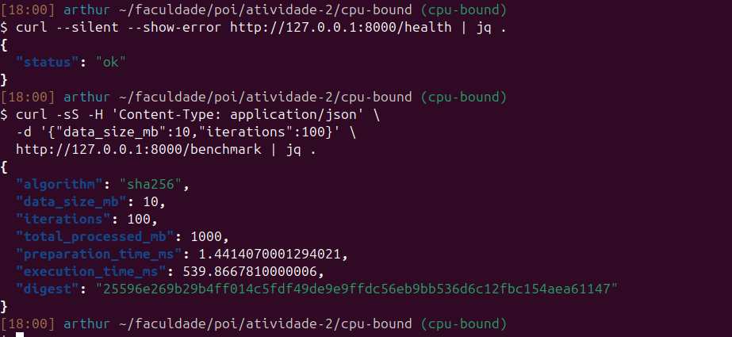

**Figura 2 — API em funcionamento.** A resposta de `/health` contém `status: ok`; `/benchmark` apresenta o algoritmo, os parâmetros 10 MiB e 100 iterações, o total lógico de 1.000 MiB, o tempo de execução e o digest. O tempo da chamada isolada exibida não é a latência HTTP sob a carga concorrente do Locust.

## 3. Ambiente experimental

Os artefatos documentam cinco configurações VirtualBox: 1, 2, 4, 6 e 8 vCPUs. Em todas, a memória atribuída foi de 1.024 MiB e a API foi iniciada com oito workers Uvicorn.

| Componente | Configuração comprovada | Evidência |
| --- | --- | --- |
| Sistema hospedeiro | Ubuntu 24.04.4 LTS, kernel 7.0.0-31-generic durante a matriz. | [`host-inventory.txt`](../results/demand-vbox-8cpu-20261014T104931Z-504345/host-inventory.txt) e [`host-os-release.txt`](../results/demand-vbox-analysis/host-os-release.txt). |
| Processador físico e RAM do hospedeiro | AMD Ryzen 5 5500, 6 núcleos/12 threads, 15.857 MiB de RAM. | [`host-inventory.txt`](../results/demand-vbox-8cpu-20261014T104931Z-504345/host-inventory.txt), coletado no hospedeiro. |
| VirtualBox no hospedeiro | VirtualBox 7.2.20r175154. | [`host-inventory.txt`](../results/demand-vbox-8cpu-20261014T104931Z-504345/host-inventory.txt). |
| Sistema convidado | Ubuntu Server 22.04.5 LTS; kernel 5.15.0-198-generic nos inventários de 2–8 vCPUs. | [`inventory.txt` de 2 vCPUs](../results/vbox-2cpu-20261013T140512Z/inventory.txt) e inventários dos demais cenários. |
| vCPUs e RAM da VM | 1, 2, 4, 6 ou 8 vCPUs; 1.024 MiB atribuídos. | Captura de configuração de 1 vCPU, `nproc` na VM e inventários/arquivos de resultados. |
| Gerador externo | Locust 2.37.14 em Python 3.12.3, no hospedeiro, fixado à CPU lógica 0. | `config.txt` e `dependencies.txt` das repetições; roteiro de execução. |

**Tabela 2 — Infraestrutura registrada.** Os registros do convidado e do gerador estão separados para não atribuir à máquina física características observadas dentro da VM.

A criação da VM utilizou o VDI fornecido para a atividade, selecionado na interface do VirtualBox. As capturas registram 1 vCPU e 1.024 MiB para a VM de demonstração, além das regras NAT TCP `127.0.0.1:2222 → VM:22` (SSH) e `127.0.0.1:8000 → VM:8000` (API). As configurações de 2, 4, 6 e 8 vCPUs não possuem capturas individuais de tela no relatório; suas contagens constam nos inventários textuais e nos estados preservados por snapshots.

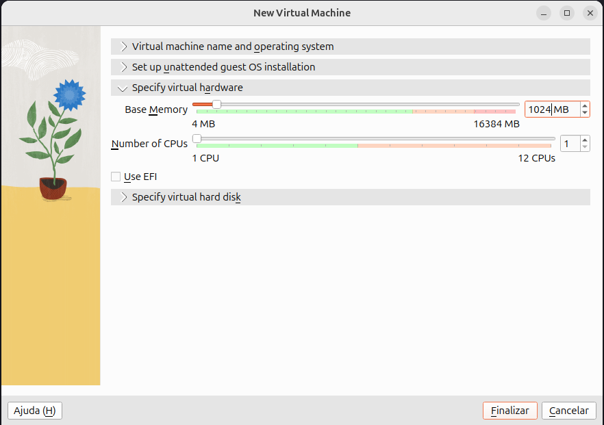

**Figura 3 — Configuração da VM de 1 vCPU.** A interface mostra 1 processador e 1.024 MiB

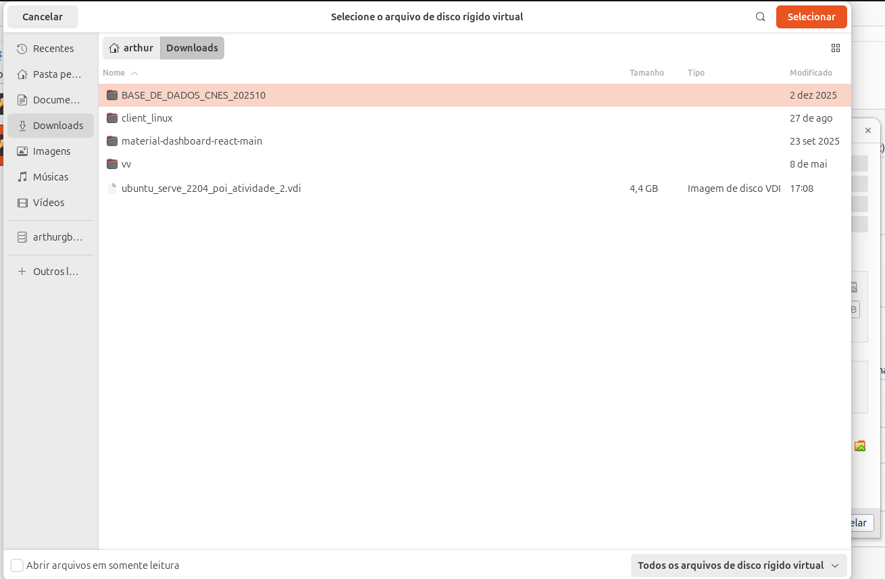

**Figura 4 — Disco da VM.** A captura mostra a seleção do VDI disponibilizado para a atividade

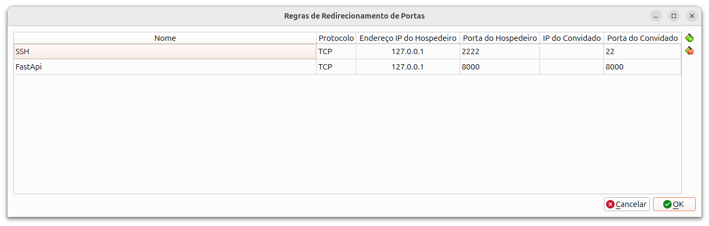

**Figura 5 — Encaminhamento de portas NAT.** As regras permitem acessar SSH pela porta 2222 e a API pela 8000 no loopback do hospedeiro

## 4. Metodologia experimental
| Variável | Valor e controle |
| --- | --- |
| Provisionamento | 1, 2, 4, 6 e 8 vCPUs; 1.024 MiB de RAM em todos os cenários. |
| Demanda | 1, 2, 4, 8 e 16 usuários; três repetições por ponto. |
| Trabalho | `POST /benchmark`, 10 MiB × 100 iterações; oito workers. |
| Duração | 120 s por repetição, conforme configuração e log do Locust. |
| Medição | Locust e registro individual de respostas no hospedeiro; `monitor.py` e `vmstat` na VM, iniciados antes da carga. |
| Janelas de comparação | A partir do primeiro registro com todos os usuários ativos: 30 s de aquecimento; descartam-se também os 5 s finais do histórico. Restam 79–80 s efetivos em cada execução. |

**Tabela 3 — Parâmetros da matriz definitiva.**


## 5. Resultados e discussão

Todos os 75 casos da matriz passaram. Houve 40.722 respostas concluídas e zero falhas/timeouts nos testes completos de 120 s; na janela comparável, 26.967 respostas e zero falhas. A execução incompleta de 32 usuários em 1 vCPU foi preservada, marcada como **fora da matriz** e excluída. As campanhas anteriores de 32 usuários por 60 s também permanecem arquivadas, sem entrar nas tabelas ou gráficos abaixo.

### 5.1. Efeito da demanda sobre a vazão

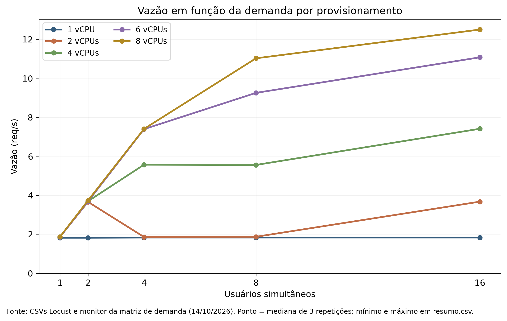

**Figura 7 — Vazão em função da demanda.** Eixo horizontal: usuários simultâneos; vertical: respostas bem-sucedidas por segundo na janela comparável. Fonte: [`resumo.csv`](../results/demand-vbox-analysis/resumo.csv).

Com apenas um usuário, os cinco cenários ficaram entre 1,81 e 1,86 req/s. Essa quantidade de usuário oferece, no máximo, uma solicitação em andamento por usuário e não ocupa todos os workers portanto, mais vCPUs não elevaram materialmente a vazão nesse ponto.

Com 1 vCPU, a vazão mediana permaneceu entre 1,81 e 1,82 req/s de 1 a 16 usuários. Já o p95 da latência, que é o tempo que 95% das requisições levaram, no máximo, para receber resposta, aumentou fortemente.

Com 8 vCPUs, a vazão passou de 1,86 req/s com 1 usuário a 12,49 req/s com 16. Isso é uma prova clara que o aumento de vCPU é uma boa forma atender mais requisições por segundo.


| Usuários | 1 vCPU | 2 vCPUs | 4 vCPUs | 6 vCPUs | 8 vCPUs |
| ---: | ---: | ---: | ---: | ---: | ---: |
| 1 | 1,81 | 1,86 | 1,86 | 1,85 | 1,86 |
| 2 | 1,81 | 3,65 | 3,68 | 3,67 | 3,72 |
| 4 | 1,82 | 1,85 | 5,56 | 7,38 | 7,39 |
| 8 | 1,82 | 1,86 | 5,54 | 9,24 | 11,01 |
| 16 | 1,82 | 3,66 | 7,40 | 11,06 | 12,49 |

**Tabela 4 — Vazão mediana (req/s) nas janelas comparáveis.** Fonte: [`resumo.csv`](../results/demand-vbox-analysis/resumo.csv).

Podemos verificar que apesar do aumento de vazão com o aumento de vCPUs para trabalhar, o acrescimo da vazão não é linear.

Contudo, o caso com 2 vCPU teve resultados diferentes do esperado. Com 3,65 req/s com 2 usuários, cerca de 1,85 com 4 e 8, e 3,66 com 16. Em 4 usuários, as três repetições variaram de 1,85 a 3,66 req/s; em 16 usuários, de 1,86 a 3,67 req/s. A queda não foi descartada como anomalia: os arquivos passaram nos critérios de validade e a variação entre repetições está registrada em `resumo.csv`. Uma hipótese é a distribuição desigual de conexões persistentes entre os processos Uvicorn; o Locust usa `HttpUser`, e cada usuário pode reutilizar sua conexão.

### 5.2. Efeito da demanda sobre a latência

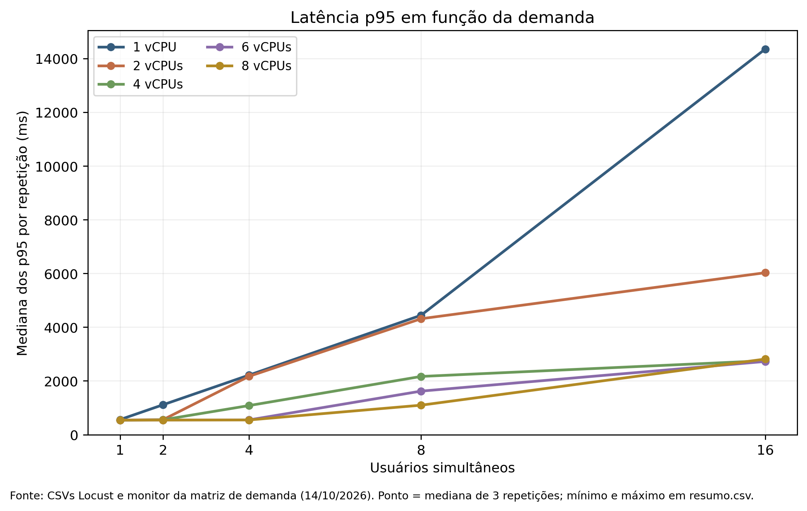

**Figura 8 — Latência p95 em função da demanda.** Cada ponto é a mediana dos p95 calculados separadamente nas três repetições

Em 1 vCPU, o p95 mediano cresceu de 559 ms com 1 usuário a 14.346 ms com 16, enquanto a vazão permaneceu quase constante. Esses valores são justificados com a espera crescente por capacidade de processamento. Já com 8 vCPUs, o p95 permaneceu próximo de 540–546 ms até 4 usuários, chegou a 1.095 ms com 8 e a 2.812 ms com 16. A configuração de 6 vCPUs registrou 548 ms com 4 usuários, 1.619 ms com 8 e 2.723 ms com 16. O cenário de 2 vCPUs mostrou 2.169 ms com 4 usuários e 4.313 ms com 8, coerentes com a menor vazão desses pontos.

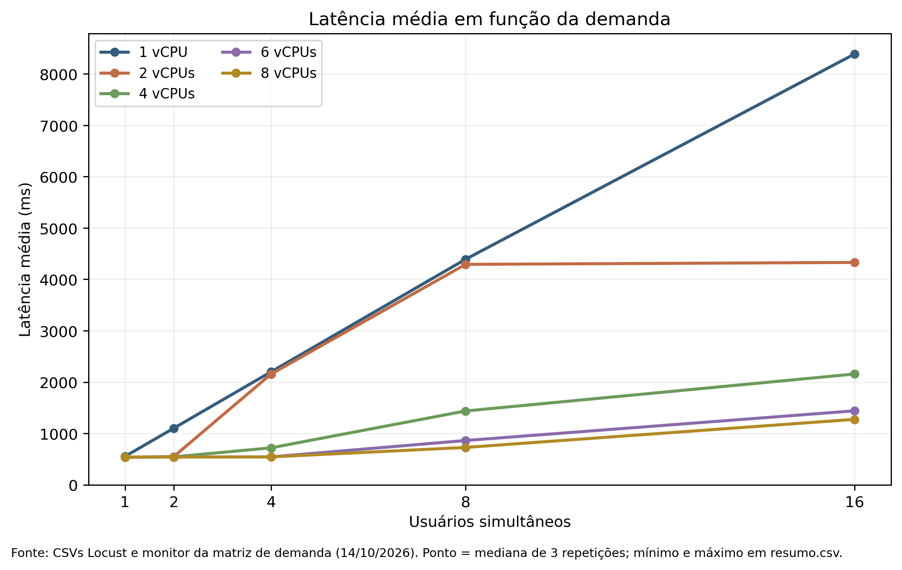

**Figura 9 — Latência média em função da demanda.** A média é calculada dentro de cada repetição, e a figura apresenta a mediana entre repetições. Fonte: [`resumo.csv`](../results/demand-vbox-analysis/resumo.csv).

A latência média confirma a tendência, sem substituir a medida de cauda: com 16 usuários, as medianas foram 8.390 ms em 1 vCPU, 4.329 ms em 2, 2.157 ms em 4, 1.440 ms em 6 e 1.274 ms em 8. O p95 de 8 vCPUs com 16 usuários (2.812 ms) ficou ligeiramente acima do de 6 vCPUs (2.723 ms); três repetições e amplitudes sobrepostas não sustentam concluir que a configuração maior piorou a cauda de forma sistemática.

### 5.3. Comportamento temporal das requisições por segundo (RPS)

RPS significa requisições por segundo, ou seja, a quantidade de respostas concluídas pelo serviço a cada segundo.

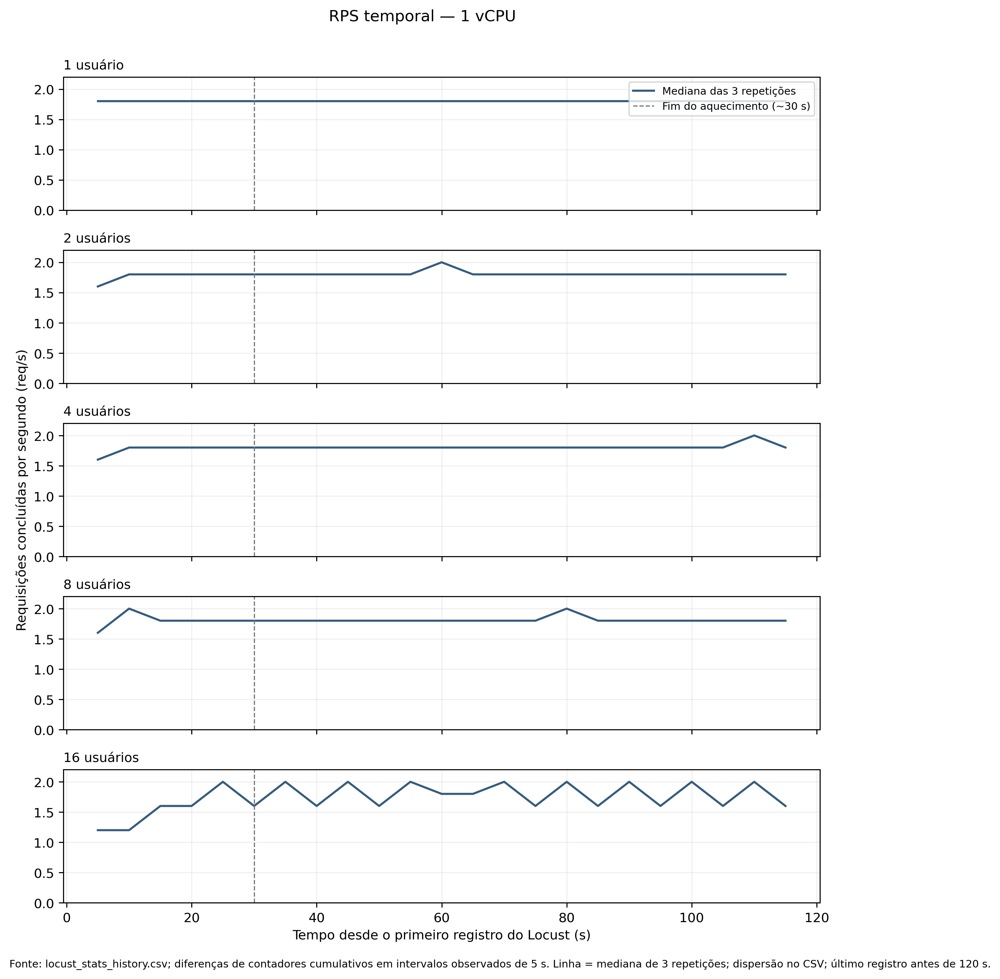

**Figura 10 — RPS temporal em 1 vCPU.** Cinco painéis representam os níveis de demanda, com a mesma escala vertical. Fonte: [`rps-temporal-resumo.csv`](../results/demand-vbox-analysis/rps-temporal-resumo.csv).

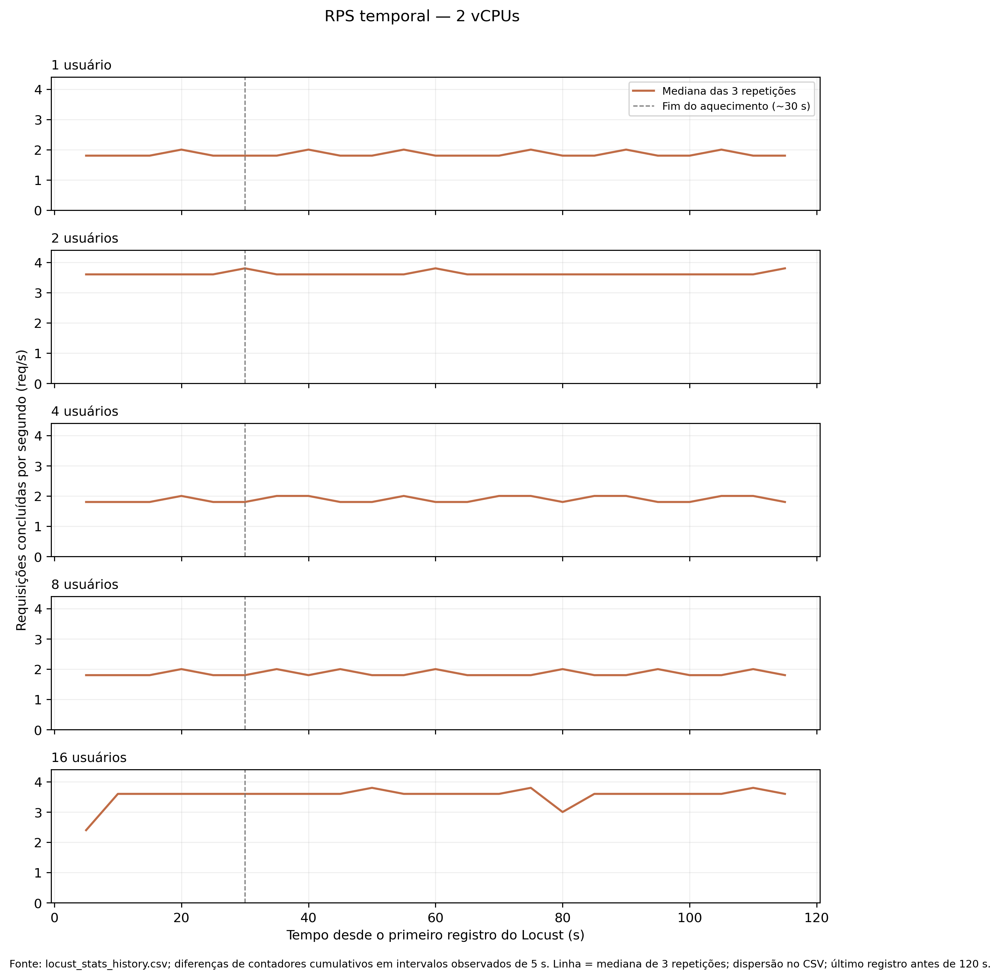

**Figura 11 — RPS temporal em 2 vCPUs.** 

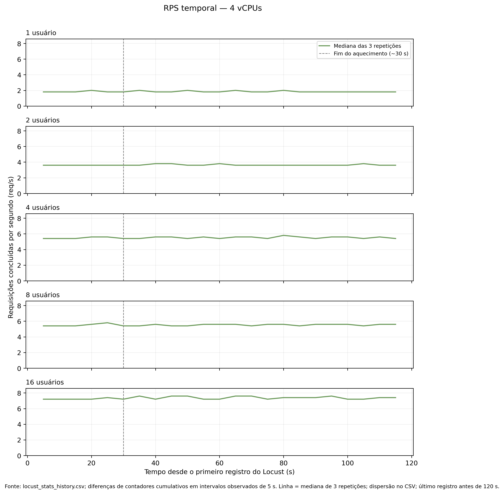

**Figura 12 — RPS temporal em 4 vCPUs.**

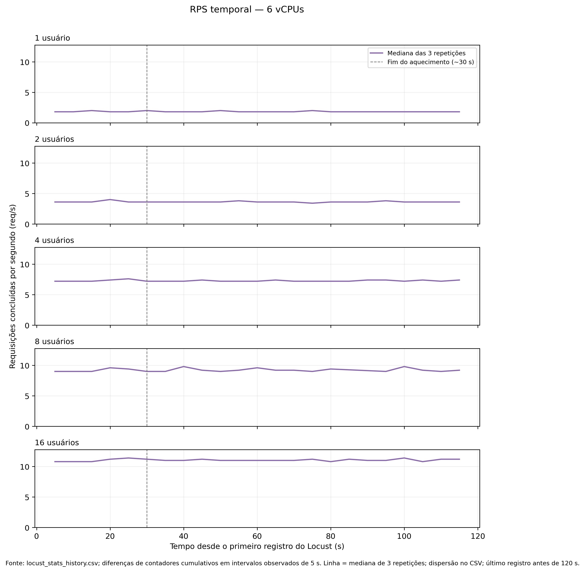

**Figura 13 — RPS temporal em 6 vCPUs.**

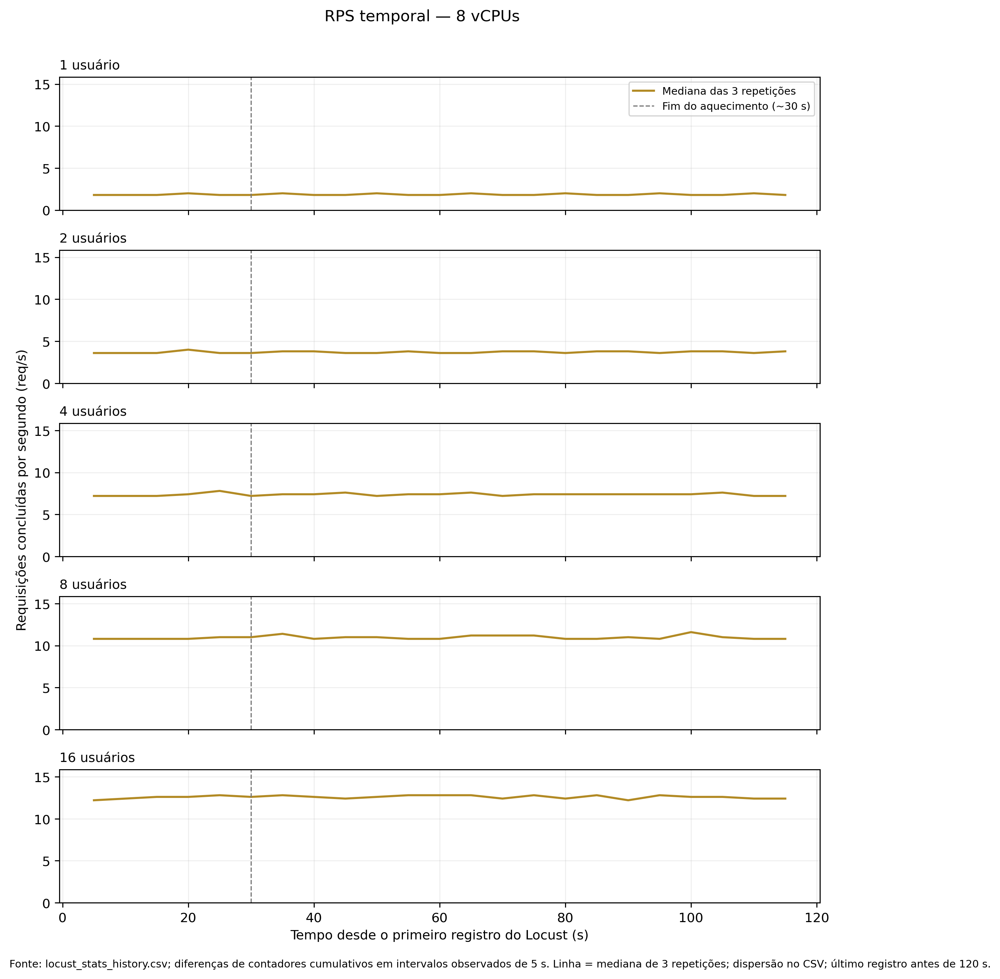

**Figura 14 — RPS temporal em 8 vCPUs.**

### 5.4. Utilização de CPU e possíveis pontos de saturação

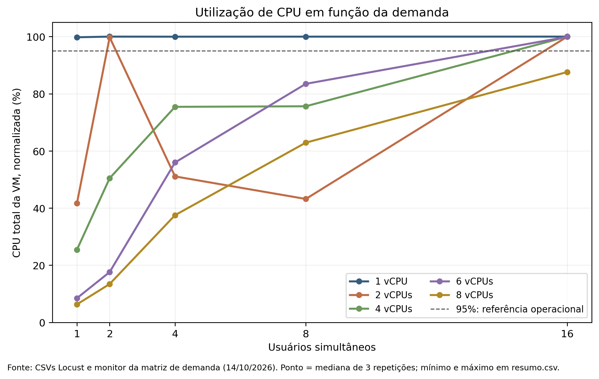

**Figura 15 — CPU total da VM em função da demanda.** Fonte: [`resumo.csv`](../results/demand-vbox-analysis/resumo.csv).

Em 1 vCPU, a utilização já foi 99,8% com um usuário e ficou aproximadamente em 100% nos demais níveis. A vazão quase constante e o p95 crescente fornecem são justificativas para o nível de uso. o primeiro nível já está próximo do limite, de modo que não é possível localizar o limiar abaixo de um usuário. Em 4 e 6 vCPUs, o primeiro nível testado acima de 95% foi 16 usuários, com medianas próximas de 100%; entretanto, a vazão ainda cresceu entre 8 e 16 usuários. Há pressão de CPU e degradação da latência. Em 8 vCPUs, a CPU mediana chegou a 87,6% com 16 usuários: a matriz não demonstrou saturação por CPU nesse cenário, embora a latência tenha aumentado.

Em 2 vCPUs, a mediana de CPU foi 99,8% com 2 e 16 usuários, mas 51,1% com 4 e 43,2% com 8. O padrão acompanha a vazão não monotônica e varia também entre repetições; por isso, não permite identificar um ponto de saturação único.

### 5.5. Total de requisições atendidas

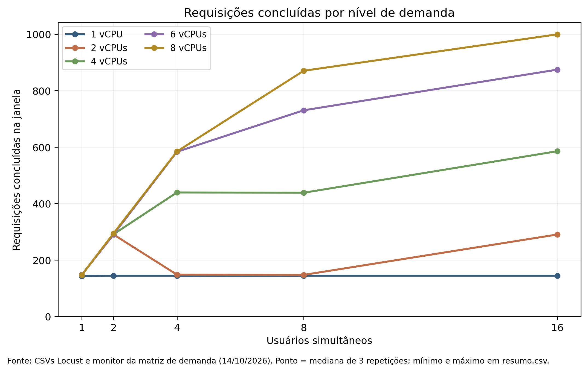

**Figura 16 — Requisições concluídas na janela comparável.** Fonte: [`resumo.csv`](../results/demand-vbox-analysis/resumo.csv).

A contagem complementa a vazão, pois usa as mesmas respostas concluídas e a mesma janela. Com 16 usuários, as medianas foram 144, 290, 585, 874 e 999 requisições, respectivamente para 1, 2, 4, 6 e 8 vCPUs. O total nas 75 janelas foi 26.967, sem falhas. As pequenas diferenças de duração entre 79 e 80 s justificam usar req/s para comparações de capacidade mais precisas; a figura de totais confirma a ordem de grandeza do atendimento efetivo.

### 5.6. Impacto do provisionamento

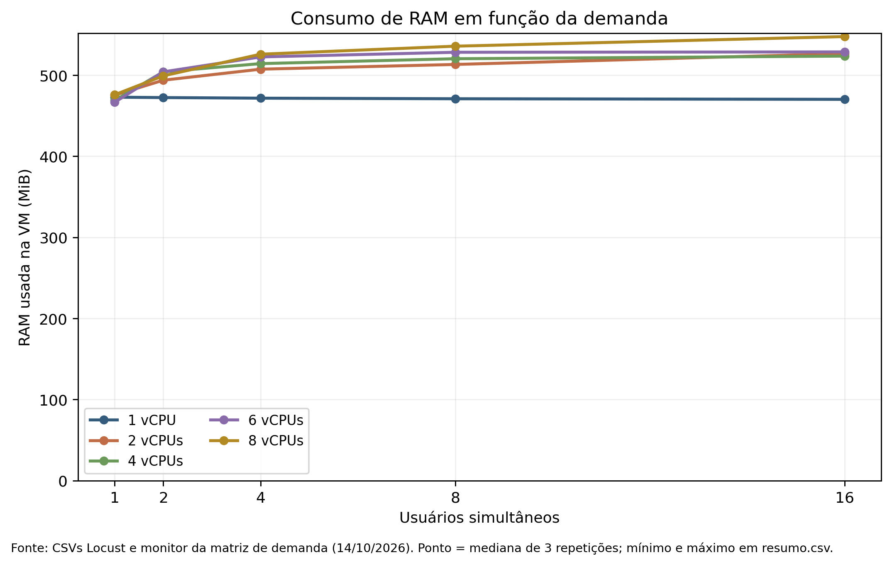

**Figura 17 — RAM usada na VM em função da demanda.** Fonte: [`resumo.csv`](../results/demand-vbox-analysis/resumo.csv).

A RAM mediana variou de aproximadamente 470 a 548 MiB entre os pontos, abaixo dos 1.024 MiB atribuídos. Isso não aponta esgotamento de memória física nos cenários de 2–8 vCPUs.

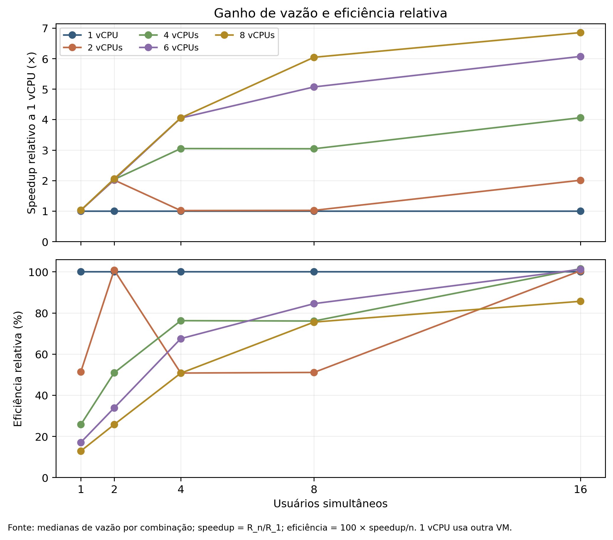

Speedup (Fator de aceleração) é calculado pela mediana da vazão de **x** vCPUs/ medianada de 1 vCPU

**Figura 18 — Ganho de vazão e eficiência relativa.**  Fonte: [`resumo.csv`](../results/demand-vbox-analysis/resumo.csv).

Com 16 usuários, a vazão passou de 1,82 req/s em 1 vCPU a 12,49 req/s em 8 vCPUs, ganho observado de **6,85×** para oito vezes o provisionamento e eficiência relativa de **85,6%**. Com um usuário, a vazão ficou quase igual e o ganho de provisionar mais CPUs foi pequeno. 

| vCPUs | Vazão com 16 usuários (req/s) | p95 mediano (ms) | CPU mediana (%) | Requisições medianas na janela | Speedup relativo a 1 vCPU |
| ---: | ---: | ---: | ---: | ---: | ---: |
| 1 | 1,82 | 14.346 | 100,0 | 144 | 1,00× |
| 2 | 3,66 | 6.025 | 100,0 | 290 | 2,01× |
| 4 | 7,40 | 2.751 | 100,0 | 585 | 4,06× |
| 6 | 11,06 | 2.723 | 99,9 | 874 | 6,07× |
| 8 | 12,49 | 2.812 | 87,6 | 999 | 6,85× |

**Tabela 5 — Comparação sob a maior demanda testada.** Todos os valores centrais são medianas de três repetições, exceto o speedup derivado delas. Fonte: [`resumo.csv`](../results/demand-vbox-analysis/resumo.csv).

### 5.7. Limitações e ameaças à validade

Os ensaios foram sequenciais e não randomizados. Não se mediram temperatura, frequência efetiva, competição por núcleos físicos, filas da API ou utilização detalhada do gerador durante cada execução.

Oito workers foram mantidos em todos os cenários para controlar a configuração do servidor, mas podem impor custos diferentes em 1 e 8 vCPUs. O teste usa SHA-256 de dados determinísticos residentes em memória e não representa uma mistura de operações reais. Três repetições mostram variação observada, sem justificar intervalos de confiança estreitos ou inferências causais. A carga fechada do Locust não mede uma taxa de chegada externa independente. O histórico temporal periódico termina antes dos 120 s completos; o arquivo individual de respostas e o log final sustentam as contagens da execução inteira, enquanto os gráficos usam apenas intervalos completos observados. Falhas HTTP e timeouts foram zero, mas isso não prova ausência de espera ou reserva de capacidade.

## 6. Conclusão

Os resultados demonstraram que o aumento da demanda provocou maior utilização de CPU e crescimento da latência, principalmente nos cenários com menor capacidade de processamento. Com 1 vCPU, a vazão permaneceu próxima de 1,8 req/s, enquanto a latência p95 passou de 559 ms, com um usuário, para 14.346 ms, com dezesseis usuários.

O aumento do provisionamento melhorou a capacidade de atendimento da aplicação. Com dezesseis usuários, a vazão passou de 3,66 req/s em 2 vCPUs para 12,49 req/s em 8 vCPUs, representando um ganho de aproximadamente 3,41 vezes para um aumento de quatro vezes na quantidade de processadores virtuais.

Apesar desse ganho, o cenário de 8 vCPUs apresentou aumento de latência conforme a demanda cresceu. A utilização média de CPU atingiu 87,6% com dezesseis usuários, indicando que a aplicação ainda não havia alcançado o critério operacional de saturação estabelecido, embora o tempo de resposta já tivesse aumentado.

De maneira geral, os experimentos mostram que o provisionamento de CPU influencia diretamente a capacidade de processamento da aplicação, mas que seus benefícios dependem da demanda oferecida e não são necessariamente proporcionais à quantidade de recursos adicionados.

## Apêndice A — Execução manual histórica e evidências visuais

### A.1. Criar a VM, habilitar SSH e verificar recursos

No VirtualBox, crie uma VM Ubuntu Server 22.04 usando o VDI da atividade, 1 vCPU, 1.024 MiB de RAM e adaptador NAT. Configure no redirecionamento de portas as regras TCP `127.0.0.1:2222 → 22` e `127.0.0.1:8000 → 8000`, como nas Figuras 3–5.

Caso o serviço SSH não esteja instalado, execute **no console da VM**:

```bash
sudo apt update
sudo apt install -y openssh-server
sudo systemctl enable --now ssh
sudo systemctl status ssh
```

No **hospedeiro**, confira a configuração e entre na VM:

```bash
ssh -p 2222 osboxes@127.0.0.1
```

Ao usar outra VM com o mesmo redirecionamento de porta `2222`, a chave SSH apresentada ao hospedeiro muda. Confirme que a VM desejada está ligada e, se aparecer o aviso de chave antiga, remova apenas a entrada desse destino com `ssh-keygen -R '[127.0.0.1]:2222'` antes de conectar novamente. Esse aviso é esperado ao alternar entre VMs distintas; não identifica, por si só, uma falha do Ubuntu.

### A.2. Clonar a branch correta dentro da VM e validar a instalação

O repositório foi clonado **dentro da VM** por HTTPS; não é necessária chave SSH do GitHub para essa etapa:

```bash
git clone --branch cpu-bound --single-branch \
  https://github.com/POI-2026-2-grupo15/atividade-2.git atividade-2-git
cd atividade-2-git
git branch --show-current
git rev-parse --short HEAD
cd cpu-bound
sudo apt update
sudo apt install -y python3.10-venv
python3 -m venv --clear .venv
.venv/bin/python -m pip install -r requirements.txt
.venv/bin/python -m pip install -r requirements-analysis.txt
.venv/bin/python -m pip check
.venv/bin/python -m pytest -q
```

O pacote `python3.10-venv` é necessário na imagem Ubuntu 22.04 usada na validação. A opção `--clear` recria uma `.venv` que tenha ficado incompleta após a falha de `ensurepip`; use-a apenas nessa pasta de trabalho, sem afetar os CSVs de resultados. A suíte completa também contém testes de análise que importam `pandas` e `matplotlib`, por isso instala-se `requirements-analysis.txt` antes de executar `pytest`.

### A.3. Iniciar a API e conferir as respostas

Em **um terminal da VM**, inicie o Uvicorn com o mesmo número de workers em todos os cenários. Use uma pasta de saída nova; se a porta 8000 já estiver ocupada, verifique a instância existente antes de tentar iniciar outra:

```bash
cd ~/atividade-2-git/cpu-bound
mkdir results/NOVA-EXECUCAO-1CPU
.venv/bin/python -m uvicorn app.main:app --host 0.0.0.0 \
  --port 8000 --workers 8 --no-access-log \
  > results/NOVA-EXECUCAO-1CPU/api.log 2>&1 &
APP_PID=$!
printf '%s\n' "$APP_PID" > results/NOVA-EXECUCAO-1CPU/api.pid
for tentativa in $(seq 1 20); do
  test -s results/NOVA-EXECUCAO-1CPU/api.log && break
  sleep 1
done
tail -n 12 results/NOVA-EXECUCAO-1CPU/api.log
ps -p "$APP_PID" -o pid,stat,args
grep -c 'Started server process' results/NOVA-EXECUCAO-1CPU/api.log
ps --ppid "$APP_PID" -o pid,stat,args
```

O Uvicorn é iniciado em segundo plano; a espera evita consultar `api.log` antes de o processo criar o arquivo. Se `tail` ainda falhar, confira o estado do PID e a existência da pasta antes de iniciar outra instância. Em um log novo, `grep -c` deve retornar **8** linhas de inicialização de workers; a lista de filhos do mestre permite conferir se eles continuam ativos (ela também pode incluir um processo auxiliar do Python). O PID salvo identifica o processo mestre usado pelo monitor. Na execução documentada, `api.log` e `api.pid` ficaram em `results/vbox-1cpu-20261013T2036Z/`. Em **outro terminal no hospedeiro**, com `jq` instalado, consulte a API pela porta redirecionada:

```bash
curl --silent --show-error http://127.0.0.1:8000/health | jq .
curl --silent --show-error -H 'Content-Type: application/json' \
  -d '{"data_size_mb":10,"iterations":100}' \
  http://127.0.0.1:8000/benchmark | jq .
```

A Figura 2 mostra as saídas reais: `status: ok` confirma o acesso HTTP; `algorithm: sha256`, `data_size_mb`, `iterations`, `total_processed_mb` e `digest` identificam o trabalho executado. `preparation_time_ms` e `execution_time_ms` são tempos internos da API. A latência observada pelo Locust inclui também transporte e espera sob concorrência. Para os prints, priorize a resposta formatada, não comandos de instalação sem saída relevante.

### A.4. Executando carga de maneira manual

O **hospedeiro** gera a carga; a **VM** hospeda a API, `monitor.py` e `vmstat`. Antes da primeira repetição de um cenário, o aquecimento documentado foi:

```bash
seq 32 | xargs -P 8 -I{} curl --silent --show-error --max-time 120 \
  -o /dev/null -w '%{http_code}\n' \
  -H 'Content-Type: application/json' \
  -d '{"data_size_mb":10,"iterations":100}' \
  http://127.0.0.1:8000/benchmark | sort | uniq -c
```

Foram obtidas 32 respostas HTTP 200 na VM de 1 vCPU. Para **cada repetição**, inicie primeiro o monitor **na VM**; o exemplo usa `rep1`:

```bash
cd ~/atividade-2-git/cpu-bound
APP_PID=$(cat results/NOVA-EXECUCAO-1CPU/api.pid)
.venv/bin/python scripts/monitor.py --pid "$APP_PID" --interval 1 \
  --output results/NOVA-EXECUCAO-1CPU/rep1-monitor.csv &
MONITOR_PID=$!
vmstat -n 1 600 > results/NOVA-EXECUCAO-1CPU/rep1-vmstat.txt &
VMSTAT_PID=$!
```

No **hospedeiro**, use o projeto no mesmo commit e um ambiente Python que contenha Locust. Se ainda não houver clone local, prepare uma pasta nova:

```bash
git clone --branch cpu-bound --single-branch \
  https://github.com/POI-2026-2-grupo15/atividade-2.git atividade-2-local
cd atividade-2-local/cpu-bound
python3 -m venv .venv
.venv/bin/python -m pip install -r requirements.txt
```

Depois, ainda **no hospedeiro**, execute a carga de 60 s:

```bash
source .venv/bin/activate
USERS=32 SPAWN_RATE=32 DURATION=60s DATA_SIZE_MB=10 ITERATIONS=100 \
  WAIT_SECONDS=0 HOST=http://127.0.0.1:8000 \
  OUTPUT_DIR=results/NOVA-EXECUCAO-1CPU/rep1 \
  taskset -c 0 bash scripts/run_load_test.sh
```

Somente **depois** de o Locust terminar, pare a coleta **na VM**:

```bash
kill -TERM "$MONITOR_PID" "$VMSTAT_PID"
```

Repita o ciclo monitor → Locust → encerramento do monitor para `rep2` e `rep3`, trocando os nomes dos arquivos e diretórios. Não reaproveite `OUTPUT_DIR`. O script grava `config.txt`, `dependencies.txt`, `locust.log` e CSVs detalhados em cada pasta `repN`; os arquivos `repN-monitor.csv` e `repN-vmstat.txt` ficam na pasta do cenário. O monitor deve cobrir toda a janela do Locust — quatro execuções históricas não satisfizeram esse critério e foram excluídas do resumo daquela campanha, preservado separadamente.

Durante uma rodada **extra de demonstração**, com os mesmos parâmetros e fora das três repetições históricas resumidas na Tabela A1, foram capturadas as Figuras A1–A3. Ela está em [`results/print-live-1cpu`](../results/print-live-1cpu/) e serve apenas de evidência visual. Para reproduzir essa demonstração, abra `top -o %CPU` **na VM** e rode **no hospedeiro** em uma pasta nova:

```bash
mkdir results/NOVA-CAPTURA-1CPU
DATA_SIZE_MB=10 ITERATIONS=100 WAIT_SECONDS=0 \
taskset -c 0 .venv/bin/python -m locust \
  -f load_tests/locustfile.py --headless \
  --host http://127.0.0.1:8000 \
  --users 32 --spawn-rate 32 --run-time 60s \
  --csv results/NOVA-CAPTURA-1CPU/locust \
  --csv-full-history \
  2>&1 | tee results/NOVA-CAPTURA-1CPU/locust.log
```

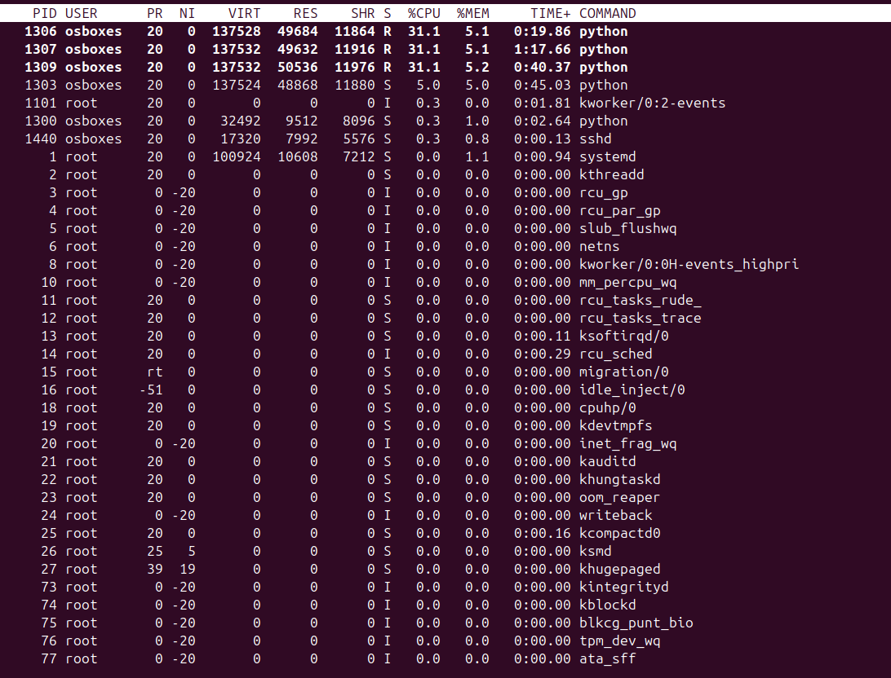

**Figura A1 — `top` na VM durante a carga visual extra.** `PID` identifica os processos; `USER=osboxes` e `COMMAND=python` permitem reconhecê-los; `RES` e `%MEM` indicam memória residente; `%CPU` é a utilização instantânea de cada processo e `TIME+` o tempo de CPU acumulado. Os três processos próximos de 31,1% e outro de 5,0% somam aproximadamente 98% de **uma** vCPU naquele instante. As médias da campanha histórica vêm dos CSVs, não desse print.

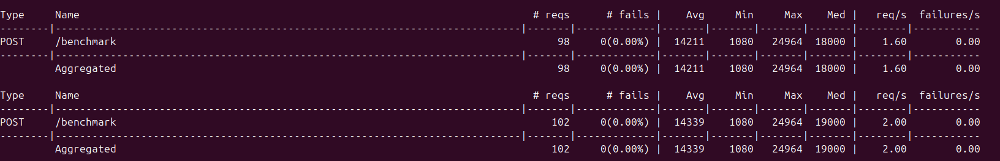

**Figura A2 — Locust durante a rodada visual extra.** `POST /benchmark` é o endpoint sob carga; `# reqs` passou de 98 a 102 nas linhas capturadas e `# fails` permaneceu em zero. `Avg`, `Min`, `Max` e `Med` são tempos HTTP em ms; `req/s` é a taxa estimada. Os 32 usuários virtuais vêm do comando, enquanto `iterations=100` significa cem hashes por **requisição**, não cem requisições.

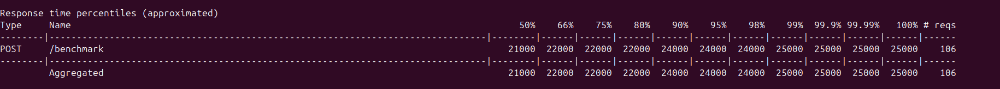

**Figura A3 — Percentis aproximados da rodada visual extra.** Com 106 requisições no momento da captura, o Locust mostrou mediana de cerca de 21.000 ms, p95 de 24.000 ms e p99 de 25.000 ms. Esses números arredondados **não** entram na matriz definitiva de 75 execuções.

### A.5. Conferir e transferir os dados sem misturar execuções

A Figura A4 registra a pasta real `results/vbox-1cpu-20261013T2036Z` **dentro da VM**. A listagem mostra as três pastas Locust e os arquivos `repN-monitor.csv`/`repN-vmstat.txt`; `rep1` contém configuração, dependências, log final e CSVs. Assim, os resultados podem ser auditados sem depender dos prints de terminal. O monitor de 1 vCPU cobriu 59, 60 e 60 amostras das janelas reais de `rep1`, `rep2` e `rep3` dessa campanha.

| Repetição de 1 vCPU | Requisições | Falhas | Vazão (req/s) | Latência média (ms) | p95 (ms) | CPU média (%) | Pico de RAM (MiB) |
| ---: | ---: | ---: | ---: | ---: | ---: | ---: | ---: |
| 1 | 108 | 0 | 1,82 | 13.869 | 33.000 | 99,1 | 646,6 |
| 2 | 108 | 0 | 1,81 | 14.945 | 23.000 | 98,6 | 648,0 |
| 3 | 105 | 0 | 1,76 | 14.162 | 35.000 | 100,0 | 647,9 |

**Tabela A1 — Bateria manual histórica registrada na VM de 1 vCPU.** As três repetições somaram 321 requisições sem falha. Esses valores pertencem à campanha de 32 usuários por 60 s e não entram nas tabelas ou gráficos da Seção 5; CPU e RAM derivam das janelas efetivas daquela carga. Fonte: [`repeticoes.csv`](../results/virtualbox-graficos/repeticoes.csv).

Para mostrar a organização dos arquivos em um terminal da **VM**, como na captura abaixo:

```bash
cd ~/atividade-2-git/cpu-bound
ls -lh results/vbox-1cpu-20261013T2036Z
ls -lh results/vbox-1cpu-20261013T2036Z/rep1
```

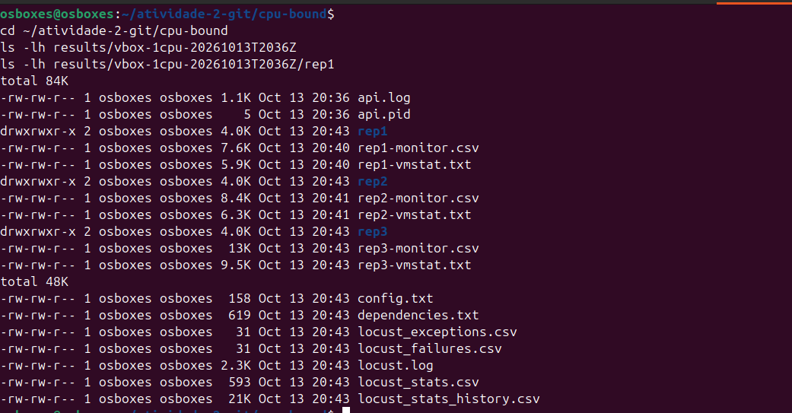

**Figura A4 — Presença dos dados brutos na VM.** O prompt `osboxes@osboxes` identifica o convidado. A captura demonstra arquivos, não a execução de uma transferência naquele momento.

Na execução documentada, a API, os arquivos do monitor e o `vmstat` foram gerados na VM; os diretórios Locust `rep1`–`rep3` foram gerados no hospedeiro. Para reunir tudo **na VM**, copie os diretórios Locust do hospedeiro por SSH (escolha uma pasta de cenário existente, sem sobrepor outra medição):

```bash
scp -O -P 2222 -r results/NOVA-EXECUCAO-1CPU/rep1 \
  results/NOVA-EXECUCAO-1CPU/rep2 \
  results/NOVA-EXECUCAO-1CPU/rep3 \
  osboxes@127.0.0.1:/home/osboxes/atividade-2-git/cpu-bound/results/NOVA-EXECUCAO-1CPU/
```

Para trazer **a cópia completa já existente** da VM ao hospedeiro, o procedimento seria executado **no hospedeiro**, dentro da pasta `cpu-bound`:

```bash
mkdir results/importacao-vm-1cpu
scp -O -P 2222 -r \
  osboxes@127.0.0.1:/home/osboxes/atividade-2-git/cpu-bound/results/vbox-1cpu-20261013T2036Z \
  results/importacao-vm-1cpu/
ls -lh results/importacao-vm-1cpu/vbox-1cpu-20261013T2036Z
```

`-r` copia recursivamente e `-O` força o protocolo SCP caso o SFTP não esteja disponível. Use uma pasta de destino **nova** em uma repetição futura. A instrução explica a procedência das cópias; nenhuma transferência adicional foi realizada para este relatório.

## Apêndice B — Execução automatizada da matriz definitiva

A matriz analisada neste relatório foi conduzida pelo orquestrador [`run_demand_curve.py`](../scripts/run_demand_curve.py), com Locust no hospedeiro e `monitor.py`/`vmstat` na VM. A Figura B1 mostra o fluxo; a Figura B3 mostra onde os dados ficam. **Esses dois esquemas são explicativos, não capturas de tela da execução.** O Apêndice A conserva as capturas autênticas da execução manual histórica.

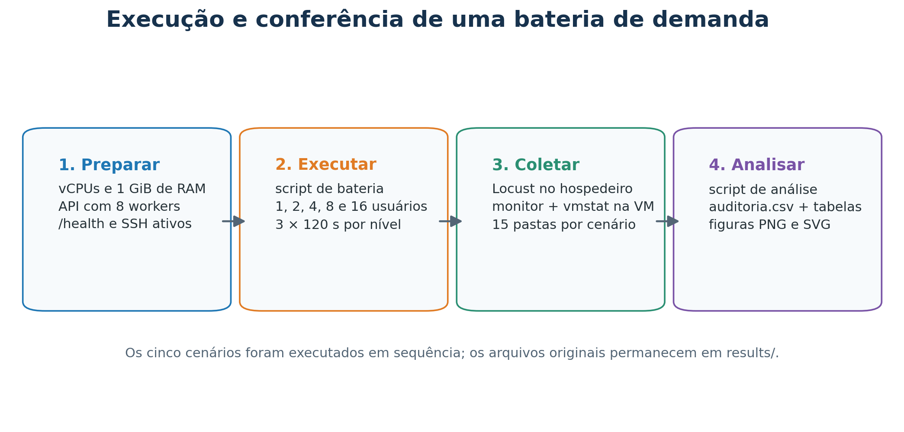

**Figura B1 — Fluxo da bateria automatizada.** Os cinco cenários foram executados sequencialmente, cada um com 15 execuções (cinco demandas × três repetições); a análise posterior lê os CSVs preservados. Fonte: scripts e diretórios citados neste apêndice.

### B.1. Preparar e executar um cenário

No **hospedeiro**, prepare o ambiente para executar o Locust e o orquestrador. Os pacotes de análise também permitem rodar a suíte completa de testes:

```bash
cd /caminho/para/atividade-2/cpu-bound
python3 -m venv .venv
.venv/bin/python -m pip install -r requirements.txt
.venv/bin/python -m pip install -r requirements-analysis.txt
.venv/bin/python -m pip check
```

Com a VM do cenário e a API ligadas, confira no **hospedeiro** o acesso SSH e o endpoint de saúde. O orquestrador confere estado, vCPUs, RAM, acesso ao projeto na VM e processo Uvicorn configurado com oito workers antes de criar os resultados. As capturas das Figuras 2–6 ilustram a preparação e conferência de serviços na VM de 1 vCPU.

```bash
ssh -p 2222 osboxes@127.0.0.1
curl -fsS http://127.0.0.1:8000/health
```

Para conferir uma VM recém-criada de 1 vCPU, execute primeiro o **smoke test** na pasta `cpu-bound` do hospedeiro:

```bash
export CPU_BOUND_VM_NAME="Nome_Que_Voce_Criou_A_VM"
export CPU_BOUND_REMOTE_PROJECT="/home/osboxes/atividade-2-git/cpu-bound"
.venv/bin/python scripts/run_demand_curve.py --vcpus 1 --smoke
```

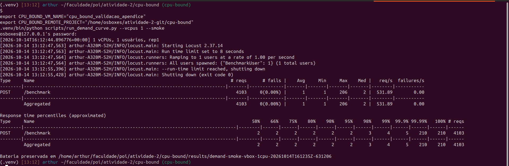

**Figura B2 — Smoke test automatizado.** A captura registra um usuário, oito segundos, 4.103 respostas e zero falhas na VM de validação. Esse teste usa 1 MiB × 1 iteração e não integra a matriz definitiva.

Substitua `Nome_Que_Voce_Criou_A_VM` pelo nome exato exibido no VirtualBox e ajuste `CPU_BOUND_REMOTE_PROJECT` se o clone do repositório estiver em outro caminho **dentro da VM**. Defina essas variáveis no terminal do **hospedeiro**, onde o script é executado. Sem elas, `--vcpus 1` seleciona a VM experimental `cpu_Bound`; as opções `--vm-name` e `--remote-project` têm prioridade sobre o ambiente.

Para executar uma **nova bateria completa** no mesmo cenário, retire `--smoke`:

```bash
.venv/bin/python scripts/run_demand_curve.py --vcpus 1
```

Esse comando produz 15 execuções de 120 s (cinco demandas × três repetições). Não o execute apenas para conferir o apêndice, pois as 75 execuções definitivas já estão preservadas. Para reproduzir outro provisionamento, desligue a VM, ajuste as vCPUs e confirme o estado correto antes de executar o comando com o novo valor de `--vcpus`.

Os parâmetros padrão do script são cinco demandas (1, 2, 4, 8 e 16 usuários), três repetições de 120 s para cada demanda, payload de 10 MiB × 100 iterações, rampa de 32 usuários/s e gerador fixado à CPU lógica 0 do hospedeiro. A API permanece com oito workers e 1.024 MiB de RAM.

A opção `--smoke` produz uma medição curta em pasta separada, fora da matriz. O script confirma os pré-requisitos, cria um diretório inédito, executa as repetições **em série** e copia os arquivos de monitoramento da VM. Ele recusa sobrescrever resultados anteriores.

### B.2. Localizar e conferir os dados

| vCPUs | Diretório da bateria definitiva | Execuções válidas |
| ---: | --- | ---: |
| 1 | [`demand-vbox-1cpu-20261014T081757Z-421203`](../results/demand-vbox-1cpu-20261014T081757Z-421203/) | 15 |
| 2 | [`demand-vbox-2cpu-20261014T085949Z-444834`](../results/demand-vbox-2cpu-20261014T085949Z-444834/) | 15 |
| 4 | [`demand-vbox-4cpu-20261014T094305Z-463098`](../results/demand-vbox-4cpu-20261014T094305Z-463098/) | 15 |
| 6 | [`demand-vbox-6cpu-20261014T101658Z-490172`](../results/demand-vbox-6cpu-20261014T101658Z-490172/) | 15 |
| 8 | [`demand-vbox-8cpu-20261014T104931Z-504345`](../results/demand-vbox-8cpu-20261014T104931Z-504345/) | 15 |

**Tabela B1 — Fontes da matriz de 75 execuções.** O smoke test e os ensaios manuais de 32 usuários estão em pastas distintas e não integram essa análise.

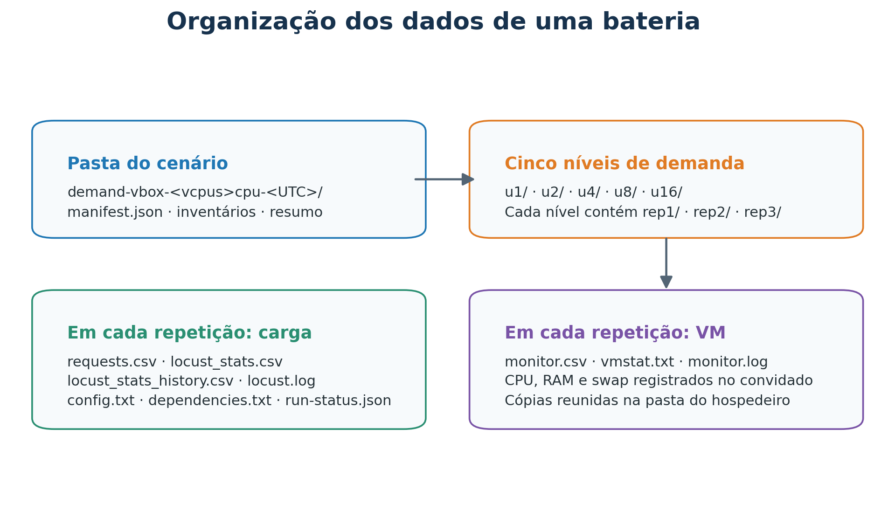

**Figura B3 — Organização dos dados brutos.** Cada bateria reúne cinco pastas de demanda `uN`, cada uma com três pastas `repN`. `requests.csv` registra respostas individuais, `locust_stats_history.csv` contém os contadores periódicos, e `monitor.csv` e `vmstat.txt` contêm medições da VM. O `manifest.json` e os arquivos `config.txt` documentam parâmetros e procedência.

Os arquivos originais permanecem em `results/`. Para conferir uma execução sem iniciar carga nova, no hospedeiro execute:

```bash
ls -lh results/demand-vbox-8cpu-20261014T104931Z-504345
ls -lh results/demand-vbox-8cpu-20261014T104931Z-504345/u16/rep3
```

### B.3. Auditar e regenerar os gráficos

O script lê os CSVs preservados e recusa sobrescrever a saída existente. Para produzir uma cópia independente da análise, use nomes de destino novos:

```bash
.venv/bin/python scripts/build_demand_report.py \
  --case results/demand-vbox-1cpu-20261014T081757Z-421203 \
  --case results/demand-vbox-2cpu-20261014T085949Z-444834 \
  --case results/demand-vbox-4cpu-20261014T094305Z-463098 \
  --case results/demand-vbox-6cpu-20261014T101658Z-490172 \
  --case results/demand-vbox-8cpu-20261014T104931Z-504345 \
  --output results/demand-vbox-analysis-verificacao \
  --figures docs/figuras/cpu-bound-verificacao
```

A [auditoria](../results/demand-vbox-analysis/auditoria.csv) registra a validade dos ensaios. [`repeticoes.csv`](../results/demand-vbox-analysis/repeticoes.csv) guarda as métricas por execução; [`resumo.csv`](../results/demand-vbox-analysis/resumo.csv) resume as 25 combinações. As taxas temporais derivadas estão em [`rps-temporal-repeticoes.csv`](../results/demand-vbox-analysis/rps-temporal-repeticoes.csv) e [`rps-temporal-resumo.csv`](../results/demand-vbox-analysis/rps-temporal-resumo.csv). Os gráficos da Seção 5 são reproduzíveis a partir desses arquivos e dos CSVs brutos das baterias da Tabela B1.
