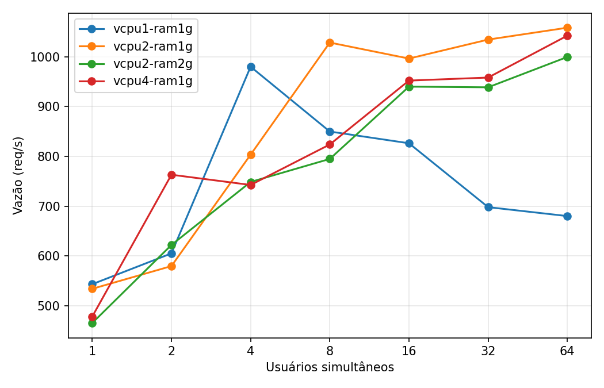
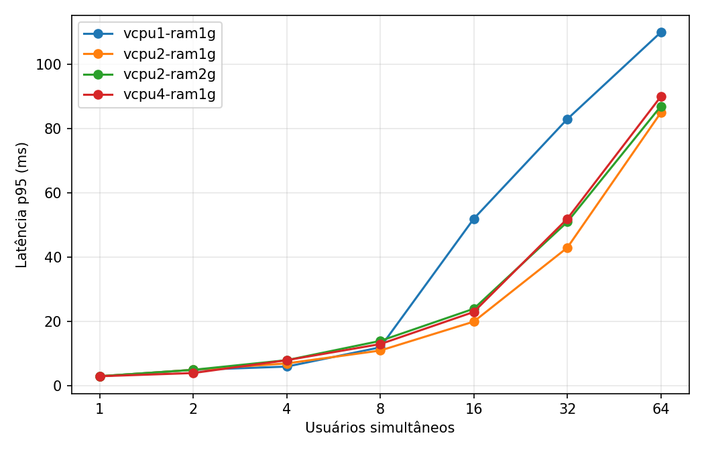
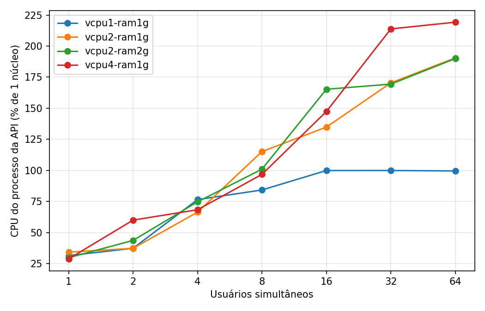
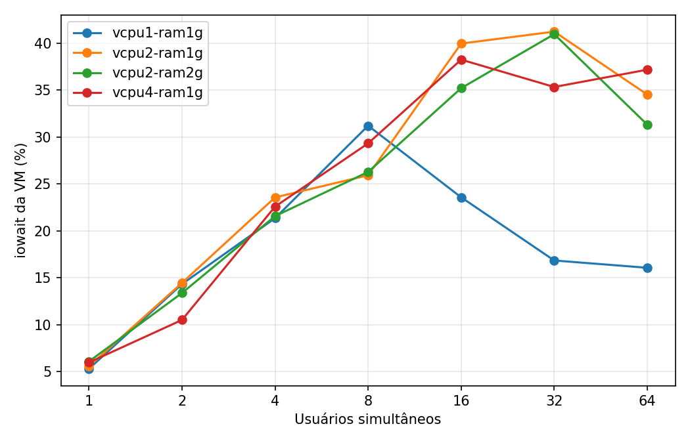
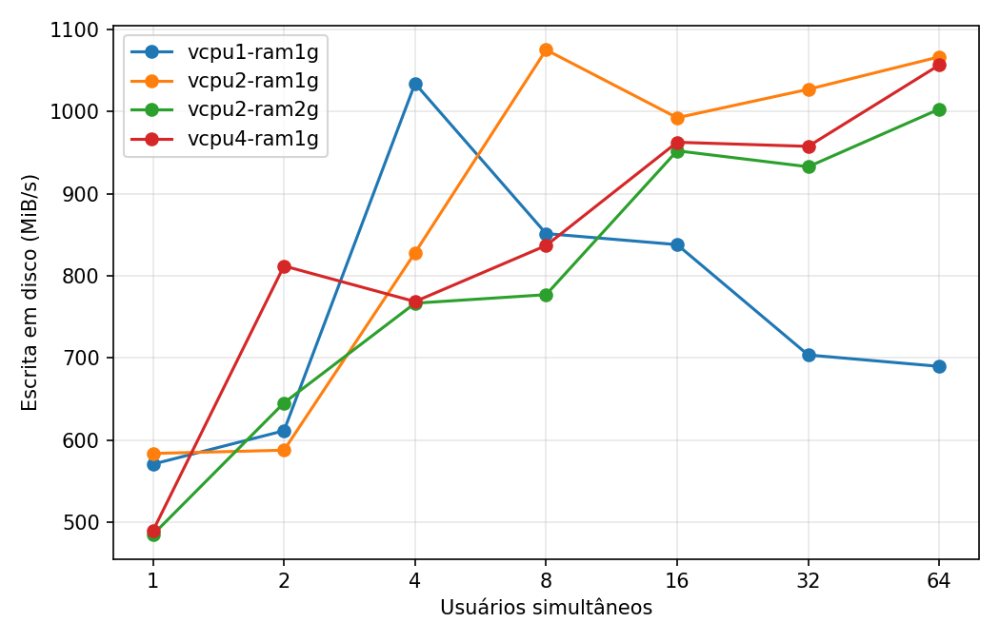

# Aplicação IO-bound: implementação e curva de demanda

## Objetivo e implementação

Foi desenvolvido um serviço FastAPI em Python cujo gargalo pretendido é o
**disco**. Cada requisição `POST /io` grava um arquivo com `size_kb` KiB,
força a gravação física com `fsync`, descarta o arquivo do page cache
(`posix_fadvise DONTNEED`), lê o arquivo de volta do disco, confere o conteúdo
e o apaga. Os dados vêm de um buffer aleatório gerado uma única vez, para que
a CPU não seja gasta produzindo conteúdo. A rota é síncrona e executa no
thread pool do FastAPI: enquanto uma thread espera o disco, outras continuam,
e um único worker atende várias requisições simultâneas.

A API oferece ainda `/health`. Os testes automatizados (11) cobrem a ida e
volta do arquivo com e sem `fsync`, a remoção dos arquivos temporários e a
validação estrita dos parâmetros.

## Monitoramento

- **Aplicação**: Locust em modo headless registra requisições, falhas, vazão
  (req/s) e percentis de latência por ponto de carga.
- **Infraestrutura**: `scripts/monitor.py` (psutil, 1 amostra/s) registra CPU
  do sistema e do processo da API, RAM disponível, RSS da aplicação,
  **iowait** e bytes/operações de leitura e escrita em disco por segundo.
- `scripts/plot_results.py` cruza os horários do Locust e do monitor e usa
  apenas o trecho em que todos os usuários já estavam ativos.

## Método do experimento

Piloto local em Docker (Docker Desktop, MacBook com Apple M5 e SSD interno).
O container da API recebeu limites de CPU e RAM para simular os cenários. O
Locust rodou em **outro container**, fora dos limites da API. Parâmetros
fixos: **1 MiB por requisição, `fsync` ligado, 1 worker, espera zero e 30 s
por ponto**. A demanda variou entre 1, 2, 4, 8, 16, 32 e 64 usuários
simultâneos.

| Cenário | CPUs | RAM |
|---|---:|---:|
| `vcpu1-ram1g` | 1 | 1 GiB |
| `vcpu2-ram1g` | 2 | 1 GiB |
| `vcpu4-ram1g` | 4 | 1 GiB |
| `vcpu2-ram2g` | 2 | 2 GiB |

O Locust usa um modelo fechado: cada usuário espera a resposta antes de enviar
a próxima requisição. O número de usuários representa concorrência, não uma
taxa de chegada fixa. Reprodução: `bash scripts/run_docker_scenarios.sh` e
`python scripts/plot_results.py --results results/docker`.

## Resultados

Nenhum dos 28 pontos teve falhas HTTP.

| Cenário | Usuários | Req/s | p95 (ms) | CPU da API (% de 1 núcleo) | iowait (%) |
|---|---:|---:|---:|---:|---:|
| 1 CPU / 1 GiB | 1 | 544 | 3 | 31 | 5 |
| | 4 | **980** (pico) | 6 | 76 | 21 |
| | 8 | 850 | 12 | 84 | 31 |
| | 64 | 680 | 110 | **99** | 16 |
| 2 CPUs / 1 GiB | 1 | 534 | 3 | 34 | 6 |
| | 8 | 1028 | 11 | 115 | 26 |
| | 64 | 1058 | 85 | 190 | 35 |
| 4 CPUs / 1 GiB | 1 | 479 | 3 | 29 | 6 |
| | 8 | 824 | 13 | 97 | 29 |
| | 64 | 1042 | 90 | 219 | 37 |
| 2 CPUs / 2 GiB | 1 | 466 | 3 | 30 | 6 |
| | 8 | 795 | 14 | 101 | 26 |
| | 64 | 999 | 87 | 190 | 31 |

Outros gráficos em `docs/img/` e tabela completa em
[`docs/img/summary.csv`](img/summary.csv).

## Interpretação

**Degradação com a demanda.** Em todos os cenários, a vazão cresce até um
teto e depois para de crescer, enquanto a latência continua subindo. Com 64
usuários, a mediana fica entre 57 e 96 ms, contra 2 ms com 1 usuário. Esse é
o comportamento previsto pela Lei de Little: com vazão fixa em ~1000 req/s,
64 usuários implicam ~64 ms de tempo médio no sistema. As requisições passam
a esperar em fila.

**Gargalo de disco (2 e 4 CPUs).** Com 2 ou 4 CPUs, o teto ficou em
**~1000–1050 req/s**, o que equivale a ~1 GiB/s de escrita mais ~1 GiB/s de
leitura com `fsync`. Dobrar a CPU de 2 para 4 **não aumentou a vazão**: com 4
CPUs, a API usou só ~55% da quota (219% de 400%), e o iowait chegou a 35–40%.
Havia CPU sobrando, e o limite era o disco: comportamento IO-bound.

**Com 1 CPU, o gargalo muda para a CPU.** O SSD é muito rápido, e o custo de
CPU de cada requisição (HTTP, JSON, chamadas de sistema e comparação do
conteúdo lido) satura um núcleo a partir de 16 usuários (CPU da API ≈ 100%).
Daí em diante, a vazão **cai** (de 980 para 680 req/s), porque as threads
disputam o núcleo e a troca de contexto aumenta. Ao mesmo tempo, o iowait
diminui, porque o disco passa a ser menos solicitado. Nesse cenário, sair de
1 para 2 CPUs aumentou a vazão máxima em ~8% e, principalmente, eliminou a
queda com alta demanda: a vazão com 64 usuários subiu 56%, de 680 para
1058 req/s.

**Memória não influencia.** Dobrar a RAM (2 CPUs com 1 GiB e com 2 GiB) não
melhorou o desempenho; as diferenças ficaram dentro da variação entre
execuções. A aplicação usa menos de 100 MiB de RSS, e o `fsync` obriga cada
escrita a chegar ao disco, então mais page cache não ajuda.

**Conclusão.** Para uma aplicação IO-bound, aumentar o provisionamento só
ajuda até a CPU deixar de ser o limite. A partir daí, a capacidade é dada
pelo disco: mais vCPUs ou mais RAM não aumentam a vazão, e mais demanda só
aumenta a latência. Para escalar, seria preciso um disco mais rápido,
reduzir o I/O por requisição (por exemplo, sem `fsync` ou com escritas em
lote) ou distribuir a carga entre discos ou máquinas.

## Limites

- Uma execução por ponto, de 30 s: há ruído (por exemplo, 4 CPUs com 2
  usuários > com 4 usuários). Não há intervalos de confiança.
- O limite de CPU do Docker é uma quota de tempo, não núcleos exclusivos, e
  o disco é compartilhado com o macOS por meio da VM do Docker Desktop. Os
  valores de iowait e disco são da VM do Docker inteira.
- O Locust compartilha a máquina física com a API.
